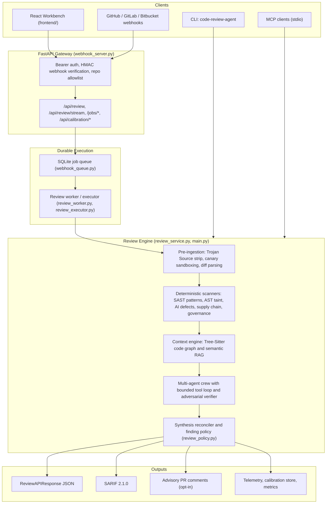
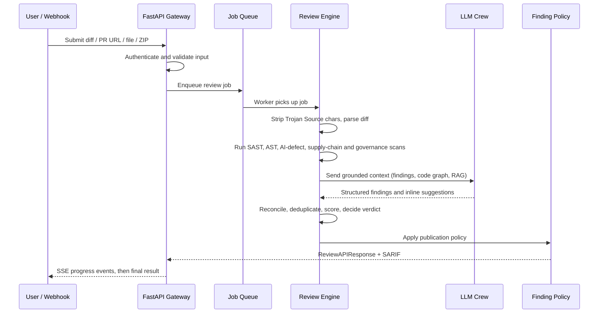

# AI Code Review Agent

<div align="center">

[](https://www.python.org/)
[](pyproject.toml)
[](LICENSE)
[](https://fastapi.tiangolo.com/)
[](frontend/package.json)
[](https://docs.oasis-open.org/sarif/sarif/v2.1.0/sarif-v2.1.0.html)
[](https://modelcontextprotocol.io)

**An advisory, evidence-first code review service that combines deterministic static analysis with a multi-agent LLM crew — and shows you exactly which line is a red flag, why, and how to fix it.**

</div>

---

## Table of Contents

1. [Overview](#overview)
2. [Key Features](#key-features)
3. [System Architecture](#system-architecture)
4. [Review Pipeline (End-to-End Flow)](#review-pipeline-end-to-end-flow)
5. [Web Workbench UI](#web-workbench-ui)
6. [Detection Coverage](#detection-coverage)
7. [Trust, Safety & Reliability Controls](#trust-safety--reliability-controls)
8. [Getting Started](#getting-started)
9. [Configuration](#configuration)
10. [Usage](#usage) — Web UI · CLI · REST API · GitHub Action · PR Bot · MCP
11. [Governance Rules (`.code-review.yaml`)](#governance-rules-code-reviewyaml)
12. [Evaluation & Benchmarks](#evaluation--benchmarks)
13. [Testing & Quality Gates](#testing--quality-gates)
14. [Deployment](#deployment)
15. [Project Structure](#project-structure)
16. [Documentation Index](#documentation-index)
17. [Known Limitations](#known-limitations)
18. [Roadmap](#roadmap)
19. [Contributing](#contributing)
20. [License](#license)

---

## Overview

AI coding assistants produce code that looks clean and passes linters, but can still ship SQL injection, plaintext password checks, hallucinated dependencies, unawaited async auth checks, or invisible Unicode tricks.

**AI Code Review Agent** reviews pull requests and diffs with one guiding principle:

> **Prefer deterministic evidence over model opinion.** Every finding should point to a file, a line, a rule/CWE, a reason, and a concrete fix.

It runs in four ways:

| Mode | Entry point | Typical user |
| :--- | :--- | :--- |
| **Web Workbench** | React SPA served by FastAPI at `http://localhost:8000` | Developers / reviewers |
| **CLI** | `code-review-agent` | Local / pre-commit / CI |
| **PR Bot & Webhooks** | `/webhook/github`, `/webhook/gitlab`, `/webhook/bitbucket` | Teams on GitHub / GitLab / Bitbucket |
| **MCP Server** | `code-review-mcp` (stdio) | Claude Code, Cursor, other MCP clients |

> [!NOTE]
> The service is **advisory by default**: it posts `COMMENT` reviews only, never merge-blocking statuses, and comment posting, auto-remediation, and sandboxed test execution are all **off by default**.

---

## Key Features

### 🔍 Analysis
- **Layered static analysis** — regex security patterns ([`sast_scanner.py`](src/code_review_agent/tools/sast_scanner.py)), AST constant-folding/taint scanner ([`ast_security_scanner.py`](src/code_review_agent/tools/ast_security_scanner.py)), plus optional **Bandit**, **Semgrep**, and **Ruff** runners.
- **AI-era defect detectors** — unawaited coroutines, blocking I/O in `async def`, hollow security stubs, cross-file contract drift ([`ai_code_detectors.py`](src/code_review_agent/tools/ai_code_detectors.py)).
- **Supply-chain scanner** — hallucinated ("slopsquatted") and typosquatted packages in dependency manifests ([`supply_chain_scanner.py`](src/code_review_agent/tools/supply_chain_scanner.py)).
- **Trojan Source shield** — strips Unicode Bidi overrides and zero-width characters before any model sees the diff ([`trojan_source.py`](src/code_review_agent/security/trojan_source.py)).
- **Code graph & semantic context** — Tree-Sitter call graph with impacted-caller and taint-path queries, plus a RAG engine (offline hashing, Gemini, or sentence-transformers embedders).

### 🤖 Reasoning
- **Multi-agent review crew** with a bounded tool loop (`codebase_context`, `semantic_context`, `ruff`, `custom_rules`) defined in [`agents.yaml`](src/code_review_agent/crews/code_review_crew/config/agents.yaml) / [`tasks.yaml`](src/code_review_agent/crews/code_review_crew/config/tasks.yaml).
- **Adversarial verifier** — an optional second-model critic that tries to disprove findings ([`adversarial_verifier.py`](src/code_review_agent/crews/code_review_crew/adversarial_verifier.py)).
- **Deterministic synthesis** — a reconciler deduplicates and scores findings so the verdict does not depend on free-form LLM prose ([`reconciler.py`](src/code_review_agent/synthesis/reconciler.py)).
- **Provider-agnostic LLM factory** — Gemini by default; OpenAI, Anthropic, Groq, and Ollama keys are supported ([`llm_factory.py`](src/code_review_agent/llm_factory.py)).

### 🖥️ Experience
- **Live Annotated Source Review** — suspicious lines are highlighted in red (critical) or amber (warning), with a `RED FLAG` gutter badge, a "Why this line is suspicious" explanation, and a one-click secure patch.
- **Real-time progress** via Server-Sent Events (`/api/review/stream`), with fallback to job polling.
- **SARIF 2.1.0 export** for GitHub Code Scanning / GitLab security dashboards.

### 🛡️ Operations
- **Durable SQLite job queue** with cancel / reconcile / result / SARIF endpoints.
- **Calibration loop** — developer feedback (`/fp`, `/confirm`, reactions), human audit sampling, and a **Tricorder-style circuit breaker** that puts noisy rules on probation.
- **Shadow mode** (`SHADOW_MODE=true`) — run full reviews without posting anything, for safe rollout.
- **Health, readiness, metrics** (`/health/live`, `/health/ready`, `/metrics`) and structured logging; optional Langfuse / OpenTelemetry tracing.

---

## System Architecture



### Component responsibilities

| Layer | Key modules | Responsibility |
| :--- | :--- | :--- |
| **Gateway** | [`webhook_server.py`](src/code_review_agent/webhook_server.py), [`gateway_security.py`](src/code_review_agent/gateway_security.py), [`access_policy.py`](src/code_review_agent/access_policy.py) | HTTP API, auth, webhook signature checks, repository allowlist, static UI hosting |
| **Queue & workers** | [`webhook_queue.py`](src/code_review_agent/webhook_queue.py), [`review_worker.py`](src/code_review_agent/review_worker.py), [`review_executor.py`](src/code_review_agent/review_executor.py) | Durable jobs, concurrency limits, process isolation, event streaming |
| **Orchestration** | [`main.py`](src/code_review_agent/main.py), [`review_service.py`](src/code_review_agent/review_service.py) | `PRCodeReviewFlow` state machine, fast path vs. full crew path |
| **Deterministic tools** | [`tools/`](src/code_review_agent/tools/), [`governance/rules_engine.py`](src/code_review_agent/governance/rules_engine.py) | SAST, AST, Bandit, Semgrep, Ruff, supply chain, governance rules |
| **Context** | [`context_engine/`](src/code_review_agent/context_engine/) | Tree-Sitter code graph, semantic vector store |
| **LLM crew** | [`crews/code_review_crew/`](src/code_review_agent/crews/code_review_crew/), [`llm_factory.py`](src/code_review_agent/llm_factory.py) | Agents, tasks, guardrails, tool registry, adversarial critic |
| **Synthesis & policy** | [`synthesis/reconciler.py`](src/code_review_agent/synthesis/reconciler.py), [`review_policy.py`](src/code_review_agent/review_policy.py), [`publication.py`](src/code_review_agent/publication.py) | Dedup, scoring, verdict, publication eligibility |
| **Platforms** | [`platform/`](src/code_review_agent/platform/) | GitHub, GitLab, Bitbucket, and local-git adapters |
| **Calibration & learning** | [`calibration/`](src/code_review_agent/calibration/), [`learning/`](src/code_review_agent/learning/), [`suppression_store.py`](src/code_review_agent/suppression_store.py) | Feedback, FP rates, circuit breaker, team memory, suppressions |
| **Observability** | [`observability/`](src/code_review_agent/observability/), [`structured_logging.py`](src/code_review_agent/structured_logging.py) | Telemetry persistence, tracing, alerts |

---

## Review Pipeline (End-to-End Flow)



**Pipeline stages streamed to the UI:** `INGESTION → AST_PRESCAN → SECURITY_SCAN → LLM_REASONING → TEST_SANDBOX → SYNTHESIS`.

**Fail-closed behaviour:** if a required analyzer fails or source is unavailable, the response is marked `analysis_complete: false`, the verdict cannot be `APPROVE`, and bot comments are withheld (`INCOMPLETE_ANALYSIS`). The web UI still shows every finding so the human can review it.

---

## Web Workbench UI

Built with **React 19, TypeScript 6, Vite 8, Tailwind CSS 4, Prism.js**, lazy-loaded views, and an operator-token login.

| View / Tab | What it shows |
| :--- | :--- |
| **Review input** | Paste diff, GitHub PR URL, single file, or ZIP. Quick presets: *SQLi & Auth PR*, *Clean Refactor*, *Governance PR*. |
| **Verdict banner** | `APPROVE` / `REQUEST CHANGES` / `ESCALATE` / `COMMENT`, confidence, summary, JSON export |
| **Full Overview** | All panels in one page |
| **AI Threat Radar** | Supply chain, Trojan Source, AI-defect counts, model consensus, SARIF download |
| **Annotated Code** | Live annotated source viewer (see below) |
| **Complete Report** | Executive narrative report |
| **Security / Governance / Inline Fixes** | Filterable finding lists with fingerprints and fixes |
| **AST Call Graph** | Interactive SVG impact graph + Mermaid export |
| **Generated Pytest** | Generated regression tests and execution status |
| **Jobs** | Queue monitor (status, cancel, results) |
| **Calibration** | False-positive rates, audit samples, circuit-breaker status |

### Live Annotated Source Review

The code viewer ([`AnnotatedCodeViewer.tsx`](frontend/src/components/AnnotatedCodeViewer.tsx)) merges **security findings, governance violations, and inline comments** into one set of line annotations, so findings show up on the code even when bot comments are withheld.

| Element | Behaviour |
| :--- | :--- |
| **Red flag lines** (CRITICAL / HIGH / BLOCKING) | Crimson gradient background, 4 px red left border, wavy red underline, pulsing `RED FLAG` gutter badge, inline `🚨 SUSPICIOUS: <rule-id>` pill |
| **Warning lines** (MEDIUM / WARNING) | Amber gradient, `WARN` badge, `⚠️ FLAGGED: <rule-id>` pill |
| **Explanation card** | Rule + CWE badge, description, **"💡 Why this line is suspicious & a red flag"** rationale |
| **Secure patch** | Red strike-through original line, green replacement, **Copy Secure Fix** button |
| **Navigation** | "Flagged suspicious lines" jump bar, minimap rail, severity filters (All / Critical / Warning / Info), unified ↔ split diff, expand/collapse all |

---

## Detection Coverage

### Security & AI-era rules (examples)

| Defect | Rule ID | CWE | Engine |
| :--- | :--- | :--- | :--- |
| SQL query f-string interpolation | `SEC-SQLI-001` | CWE-89 | SAST pattern |
| SQL query string concatenation | `SEC-SQLI-002` | CWE-89 | SAST pattern |
| Plaintext password comparison | `SEC-AUTH-001` | CWE-256 | SAST pattern |
| Hardcoded secrets | `SEC-SECRET-*` | CWE-798 | SAST pattern |
| Command injection / path traversal / insecure deserialization / disabled TLS / permissive file modes | `SEC-00x` | CWE-78 / 22 / 502 / 295 / 732 | AST scanner |
| Hallucinated package (slopsquatting) | `SEC-SLOPSQUAT-001` | CWE-1357 | Supply chain |
| Typosquatted package | `SEC-TYPOSQUAT-002` | CWE-1357 | Supply chain |
| Unicode Bidi / zero-width (Trojan Source) | `SEC-TROJAN-001` | CWE-1076 | Trojan Source scanner |
| Unawaited coroutine in condition | `AI-ASYNC-001` | — | AI defect detector |
| Blocking I/O in `async def` | `AI-ASYNC-002` | — | AI defect detector |
| Hollow security stub | `AI-STUB-001` | — | AI defect detector |
| Cross-file arity / contract drift | `AI-CONTRACT-001` | CWE-628 | Code graph |

The full rule list lives in the scanner modules under [`src/code_review_agent/tools/`](src/code_review_agent/tools/).

### Language support

| Capability | Languages |
| :--- | :--- |
| Regex SAST + governance rules | Language-agnostic (diff text) |
| AST security scanner, Bandit, Ruff, generated pytest | Python |
| Tree-Sitter code graph | Python, TypeScript/TSX, JavaScript/JSX, Go, Java, Rust |
| Supply-chain manifests | `requirements.txt`, `pyproject.toml`, `package.json`, `go.mod`, `Cargo.toml` |

---

## Trust, Safety & Reliability Controls

| Control | Where | Default |
| :--- | :--- | :--- |
| Operator bearer token for UI/API | `REVIEW_API_TOKEN`, `REVIEW_REQUIRE_AUTH` | Required in production |
| Webhook HMAC / token verification | `GITHUB_WEBHOOK_SECRET`, `GITLAB_WEBHOOK_SECRET`, `BITBUCKET_WEBHOOK_SECRET` | Required for webhooks |
| Repository & host allowlist | `REVIEW_ALLOWED_REPOSITORIES`, `REVIEW_ALLOWED_HOSTS` | Required in production compose |
| Slash-command authorization | `BOT_ALLOWED_ASSOCIATIONS`, `BOT_ALLOWED_USERS` | Owners / members / collaborators; fail-closed on GitLab/Bitbucket |
| Prompt-injection hardening | Trojan Source stripping + canary-tagged untrusted payloads | On |
| Publication policy | [`review_policy.py`](src/code_review_agent/review_policy.py) — withholds ungrounded, duplicate, non-actionable, suppressed, probationary, or incomplete findings | On |
| Posting / remediation / sandbox tests | `REVIEW_ENABLE_POSTING`, `REVIEW_ENABLE_REMEDIATION`, `REVIEW_ENABLE_EXPERIMENTAL_TESTS` | **Off** |
| Sandbox image pinning | `REVIEW_SANDBOX_IMAGE` (immutable digest only) | Unset → no execution |
| Shadow mode | `SHADOW_MODE=true` | Off |
| Noisy-rule circuit breaker | `/api/calibration/circuit-breaker/*` | Available |
| Data handling policy | `REVIEW_DATA_POLICY`, [`docs/DATA_TRANSFER_POLICY.md`](docs/DATA_TRANSFER_POLICY.md) | Operator-defined |
| Container hardening | read-only FS, non-root UID 10001, `cap_drop: ALL`, `no-new-privileges`, CPU/mem/PID limits | Production compose |

Every finding carries a stable **fingerprint**, so it can be explained, suppressed, confirmed, or reported as a false positive and tracked across commits (`NEW` / `RESOLVED` / `REGRESSED` / `SUPPRESSED`).

---

## Getting Started

### Prerequisites

- Python **3.10 – 3.13** and [`uv`](https://docs.astral.sh/uv/)
- Node.js **18+** (only to rebuild the frontend)
- An LLM API key (Gemini by default — [Google AI Studio](https://aistudio.google.com/))
- Optional: Docker (production deployment / sandbox), a GitHub token (live PR reviews)

### Local setup

```bash
git clone https://github.com/hamza1713/AI-Code-Review-Agent.git
cd AI-Code-Review-Agent

# 1. Python dependencies
uv sync --dev

# 2. Environment
cp .env.example .env        # set GEMINI_API_KEY (and GITHUB_TOKEN for PR reviews)

# 3. Build the web UI (served by the backend from frontend/dist)
npm --prefix frontend install
npm --prefix frontend run build

# 4. Start the server on http://localhost:8000
uv run review-server
```

**Hot-reload development (two terminals):**

```bash
scripts/dev-backend.sh      # or scripts\dev-backend.bat on Windows  → API on :8000
scripts/dev-frontend.sh     # or scripts\dev-frontend.bat on Windows → Vite dev server
```

**Check your environment:**

```bash
uv run code-review-agent --doctor
```

---

## Configuration

All settings come from environment variables (see [`.env.example`](.env.example) for the full annotated list).

| Variable | Default | Purpose |
| :--- | :--- | :--- |
| `GEMINI_API_KEY` | — | Gemini key (default provider) |
| `OPENAI_API_KEY` / `ANTHROPIC_API_KEY` / `GROQ_API_KEY` / `OLLAMA_BASE_URL` | — | Alternative providers |
| `LLM_MODEL` | `gemini/gemini-3.1-flash-lite-preview` | LiteLLM-style model id |
| `MAX_TOKENS` | `4096` | Max tokens per LLM response |
| `LLM_REQUEST_TIMEOUT` | `60` (compose) | Per-request LLM timeout (seconds) |
| `GITHUB_TOKEN` | — | Fetch PRs and post advisory comments |
| `GITHUB_WEBHOOK_SECRET` | — | Webhook signature secret |
| `APP_ENV` | `development` | `production` enables strict fail-closed gates |
| `REVIEW_API_TOKEN` | — | Operator token (≥ 32 chars) for UI/API |
| `REVIEW_ALLOWED_REPOSITORIES` | — | `provider:host/owner/repo` allowlist |
| `REVIEW_ENABLE_POSTING` | `false` | Allow posting PR comments |
| `REVIEW_ENABLE_REMEDIATION` | `false` | Allow `/review apply` patch commits |
| `REVIEW_ENABLE_EXPERIMENTAL_TESTS` | `false` | Allow sandboxed pytest execution |
| `REVIEW_SANDBOX_IMAGE` | — | Immutable sandbox image digest |
| `SHADOW_MODE` | `false` | Review without posting |
| `QUEUE_DB_PATH` | — | SQLite queue location |
| `MAX_CONCURRENT_REVIEWS` / `MAX_QUEUE_CAPACITY` | `2` / `100` (compose) | Back-pressure limits |
| `RAG_ENABLED` / `RAG_EMBEDDER` | `true` / `hashing` | Semantic context (`hashing`, `gemini`, `sentence-transformers`) |
| `RAG_REPO_ROOTS` | — | Extra repos for cross-repo context |
| `BOT_ALLOWED_ASSOCIATIONS` | `OWNER,MEMBER,COLLABORATOR` | Who can run cost-bearing commands |
| `BOT_CLONE_REPO` | `true` | Clone PR repo into an isolated temp dir for context |
| `EVAL_LLM_MODEL` | same as `LLM_MODEL` | LLM-as-judge model |

---

## Usage

### 1. Web UI

Open `http://localhost:8000`, enter the operator token, pick a preset (e.g. **SQLi & Auth PR**) or paste a diff, and click **Review code** (`Ctrl/⌘ + Enter`). Open **Annotated Code** to see red-flagged lines with explanations and fixes.

### 2. CLI

```bash
code-review-agent --file path/to/change.diff               # review a diff file
code-review-agent --pr "owner/repo/pull/42"                 # review a GitHub PR
code-review-agent --file change.diff --sarif results.sarif  # export SARIF 2.1.0
code-review-agent --server --port 8000                      # start the API server
code-review-agent --doctor                                  # environment diagnostics
code-review-agent file_a.py file_b.py                       # review staged files (pre-commit)
```

Additional entry points: `review-server`, `eval-benchmarks`, `review-db` (queue DB operations), `review-pilot` (rollout controls), `code-review-mcp`.

### 3. REST API

| Method & path | Purpose |
| :--- | :--- |
| `POST /api/review` | Synchronous review → `ReviewAPIResponse` |
| `POST /api/review/stream` | Review with SSE progress events |
| `POST /api/review/sarif` | Convert a review result to SARIF |
| `GET /jobs`, `GET /jobs/{id}`, `GET /jobs/{id}/result`, `GET /jobs/{id}/sarif` | Job queue access |
| `POST /jobs/{id}/cancel`, `POST /jobs/{id}/reconcile` | Job control |
| `GET/POST /api/suppressions`, `DELETE /api/suppressions/{fingerprint}` | Suppression management |
| `POST /api/remediation/apply` | Queue a verified patch (requires remediation flag) |
| `POST /api/bot/command` | Run a slash command via REST |
| `/api/calibration/*` | Metrics, feedback, audit samples, circuit breaker |
| `POST /webhook/{github,gitlab,bitbucket}` | Platform webhooks |
| `GET /health`, `/health/live`, `/health/ready`, `/health/db`, `/metrics`, `/jobs/metrics` | Health & metrics |

```bash
curl -X POST http://localhost:8000/api/review \
  -H "Authorization: Bearer $REVIEW_API_TOKEN" \
  -F "raw_diff=<samples/benchmarks/sql_injection.diff"
```

Form fields accepted by `/api/review`: `raw_diff` (text), `pr_url`, `file` (single source file), `zip_file` (repository archive). Send `Prefer: respond-async` to enqueue a job and poll `/jobs/{id}` instead of waiting.

### 4. GitHub Action

```yaml
on:
  pull_request:
    types: [opened, synchronize, reopened]

jobs:
  review:
    runs-on: ubuntu-latest
    permissions:
      contents: read
      pull-requests: write
      security-events: write
    steps:
      - uses: actions/checkout@v4
      - uses: hamza1713/AI-Code-Review-Agent@main
        with:
          github_token: ${{ secrets.GITHUB_TOKEN }}
          gemini_api_key: ${{ secrets.GEMINI_API_KEY }}
          sarif_output: code-review-results.sarif   # uploaded to Code Scanning by the action
```

### 5. PR Bot slash commands

| Command | Purpose |
| :--- | :--- |
| `/review` · `/review rerun` | Run / re-run the review on the current head |
| `/review explain <fp>` | Root cause, CWE, and fix for a finding |
| `/review apply <fp>` | Commit a verified patch (remediation must be enabled) |
| `/review suppress <fp> [reason]` · `/review unsuppress <fp>` | Manage suppressions |
| `/fp <fp> [reason]` · `/confirm <fp>` | Feedback for calibration |
| `/audit [n]` · `/audit-confirm` · `/audit-reject` | Human audit sampling |
| `/calibration` | Rule false-positive rates |
| `/describe` · `/improve` · `/ask <question>` | PR summary, improvement ideas, grounded Q&A |
| `/compliance` · `/ticket #42` | Governance rules / ticket acceptance criteria |
| `/learn <rule>` · `/memory` | Teach and view team conventions |
| `/benchmark` · `/help` | Run benchmarks / list commands |

### 6. MCP server

```json
{
  "mcpServers": {
    "ai-code-reviewer": { "command": "code-review-mcp" }
  }
}
```

Tools: `review_diff`, `scan_sast_patterns`, `check_governance_rules`, `find_impacted_callers`, `query_semantic_context`, `generate_unit_tests`, `get_team_memory`, `verify_ticket_compliance`.

---

## Governance Rules (`.code-review.yaml`)

Repository-specific standards are evaluated deterministically with no LLM cost:

```yaml
version: "1.0"
rules:
  - id: "gov-no-raw-sql"
    name: "Forbid raw SQL string interpolation"
    severity: "BLOCKING"          # BLOCKING | WARNING | INFO
    pattern: "db\\.(?:query|execute)\\s*\\(\\s*f[\"']"
    description: "Raw SQL queries using f-string interpolation are prohibited."
    suggested_fix: "db.query('SELECT * FROM users WHERE id = %s', (user_id,))"
```

`BLOCKING` violations are rendered as red flags in the annotated viewer; `WARNING` as amber.

---

## Evaluation & Benchmarks

| Suite | Location | What it measures |
| :--- | :--- | :--- |
| **Deterministic scanner regression** | [`samples/benchmarks/`](samples/benchmarks/), [`benchmarks.py`](src/code_review_agent/benchmarks.py) | 14 synthetic seeded-defect diffs; precision / recall / F1 / verdict accuracy |
| **Public PR corpus v1 / v2** | [`samples/evaluation/`](samples/evaluation/) | Frozen real Flask PRs with licenses and head snapshots |
| **Deterministic evaluators** | [`eval/deterministic_evaluators.py`](src/code_review_agent/eval/deterministic_evaluators.py) | Line validity, suggestion compilation, grounding |
| **LLM-as-judge** | [`eval/custom_metrics.py`](src/code_review_agent/eval/custom_metrics.py), `tests/eval/` | Traceability and quality (DeepEval, optional `eval` extra) |

```bash
uv run eval-benchmarks --publish      # regenerates BENCHMARK_REPORT.md
```

Latest deterministic run ([`BENCHMARK_REPORT.md`](BENCHMARK_REPORT.md)): **14 cases, 18 TP, 0 FP, 0 FN** (precision/recall/F1 = 100%).

> [!WARNING]
> These are **synthetic regression fixtures**, not a product-quality study. They prove the scanners still catch known patterns; they do not measure real-world precision or recall. See [`docs/EVALUATION_PROTOCOL_V2.md`](docs/EVALUATION_PROTOCOL_V2.md) for the planned real-PR methodology.

---

## Testing & Quality Gates

```bash
uv run pytest                          # fast suite (excludes `slow`)
uv run pytest -o addopts='' tests/     # full suite including slow tests
uv run pytest -m deterministic_eval    # zero-cost deterministic evals
uv run ruff check src tests scripts    # lint
uv run mypy src/code_review_agent/models.py   # type-check (CI checks a production boundary list)

npm --prefix frontend run lint         # oxlint --deny-warnings
npm --prefix frontend run build        # tsc + vite production build
npm --prefix frontend run test:e2e     # Playwright end-to-end tests
```

Pytest markers: `slow`, `sandbox_integration`, `eval`, `deterministic_eval`.

**CI** ([`.github/workflows/ci.yml`](.github/workflows/ci.yml)) runs on every push/PR:

| Job | Checks |
| :--- | :--- |
| `python` | Full test suite on Python 3.10, 3.11, 3.12, 3.13 |
| `static` | Ruff, mypy on the production boundary, `pip-audit --strict` |
| `secrets` | Gitleaks scan |
| `image-and-recovery` | Image build/smoke and recovery drill |

Each job writes a signed gate record (`scripts/record_gate.py`) used by the release process in [`docs/RELEASE_GATES.md`](docs/RELEASE_GATES.md).

---

## Deployment

### Production (Docker Compose + Caddy TLS)

[`docker-compose.yml`](docker-compose.yml) runs a **Caddy** reverse proxy (automatic TLS) in front of a hardened **web** container. It deliberately refuses to start unless the release is pinned and the security settings are present:

```bash
export REVIEW_DOMAIN=review.example.com
export REVIEW_IMAGE=ghcr.io/you/code-review@sha256:<digest>
export REVIEW_IMAGE_DIGEST=sha256:<digest>
export REVIEW_DEPLOYED_COMMIT=<git-sha>
export REVIEW_API_TOKEN=<random ≥32 chars>
export REVIEW_ALLOWED_REPOSITORIES=github:github.com/owner/repo
export GITHUB_TOKEN=... GITHUB_WEBHOOK_SECRET=... BOT_GITHUB_LOGIN=...
export LLM_MODEL=gemini/gemini-3.1-flash-lite-preview
export REVIEW_DATA_POLICY_FILE=/etc/review/data-policy.json

docker compose up -d
```

Container hardening: read-only root FS, non-root user, all capabilities dropped, `no-new-privileges`, 6 GB / 4 CPU / 256 PID limits, persistent `/data` volume for the queue DB.

### Other targets

- **Render**: [`render.yaml`](render.yaml)
- **Single image**: [`Dockerfile`](Dockerfile) (multi-stage: builds the React UI, then the Python service)

Operational runbooks: [`docs/OPERATIONS.md`](docs/OPERATIONS.md), [`docs/SECURE_OPERATION.md`](docs/SECURE_OPERATION.md), [`docs/PILOT_RUNBOOK.md`](docs/PILOT_RUNBOOK.md).

---

## Project Structure

```
.
├── .code-review.yaml              # Governance rules for this repo
├── .env.example                   # Annotated configuration template
├── .github/workflows/             # CI + self-review workflow
├── action.yml                     # Reusable GitHub Action
├── Dockerfile · docker-compose.yml · render.yaml · deploy/Caddyfile
├── BENCHMARK_REPORT.md            # Generated scanner regression report
├── docs/                          # Architecture, operations, security, evaluation docs
├── samples/
│   ├── benchmarks/                # 14 seeded-defect diffs + manifest
│   └── evaluation/                # Frozen public PR corpora (v1, v2)
├── scripts/                       # Dev launchers, release/gate tooling, corpus freezing
├── notebooks/                     # PEFT fine-tuning experiment
├── frontend/                      # React 19 + TS + Vite workbench
│   └── src/
│       ├── App.tsx                # Shell, auth, SSE + job polling
│       ├── api.ts                 # Authenticated fetch helper
│       ├── types/review.ts        # API response types
│       └── components/
│           ├── ReviewInput.tsx            # Diff / PR / file / ZIP input + presets
│           ├── PipelineProgress.tsx       # Live stage stepper
│           ├── ReviewDashboard.tsx        # Tabs and result layout
│           ├── VerdictBanner.tsx          # Verdict, confidence, export
│           ├── AnnotatedCodeViewer.tsx    # Red-flag line highlights, rationale, secure patches
│           ├── AIThreatRadar.tsx          # Supply chain, Trojan Source, consensus, SARIF
│           ├── FindingsList.tsx · GovernanceViolations.tsx · InlineCommentsList.tsx
│           ├── CrossFileImpact.tsx        # SVG call graph + Mermaid export
│           ├── GeneratedUnitTests.tsx · CompleteExecutiveReport.tsx · TelemetryCard.tsx
│           ├── JobsQueueMonitor.tsx       # Queue view
│           └── CalibrationView.tsx · CalibrationConsole.tsx
├── src/code_review_agent/
│   ├── main.py                    # PRCodeReviewFlow orchestrator + CLI
│   ├── review_service.py          # Review execution and response building
│   ├── review_policy.py           # Publication eligibility policy
│   ├── webhook_server.py          # FastAPI gateway + UI hosting
│   ├── webhook_queue.py · review_worker.py · review_executor.py · worker.py
│   ├── gateway_security.py · access_policy.py · path_validation.py · data_policy.py
│   ├── diff_parser.py · models.py · review_contracts.py · source_snapshot.py
│   ├── sarif_exporter.py · publication.py · comment_synchronizer.py · remediator.py
│   ├── llm_factory.py · cache.py · config.py · structured_logging.py
│   ├── bot/                       # Slash-command router, safe checkout
│   ├── calibration/               # Feedback, audit sampling, circuit breaker API
│   ├── compliance/                # Ticket parsing and intent checks
│   ├── context_engine/            # Code graph + semantic RAG
│   ├── crews/code_review_crew/    # Agents, tasks, guardrails, tool registry, critic
│   ├── eval/                      # Corpus, matching, evaluators, runner
│   ├── governance/                # .code-review.yaml rules engine
│   ├── learning/                  # Team memory, suggestion tracking
│   ├── observability/             # Telemetry, tracer, alerts
│   ├── platform/                  # GitHub / GitLab / Bitbucket / local adapters
│   ├── sandbox/                   # Isolated test runner + self-healer
│   ├── security/                  # Trojan Source + canary protection
│   ├── synthesis/                 # Deterministic reconciler
│   └── tools/                     # SAST, AST, Bandit, Semgrep, Ruff, supply chain, AI defects
└── tests/                         # Unit, integration, eval, and phase-gate tests
```

---

## Documentation Index

| Document | Topic |
| :--- | :--- |
| [`docs/ARCHITECTURE_AND_STRUCTURE.md`](docs/ARCHITECTURE_AND_STRUCTURE.md) | Detailed architecture |
| [`docs/PRODUCTION_ARCHITECTURE.md`](docs/PRODUCTION_ARCHITECTURE.md) | Production topology |
| [`docs/OPERATIONS.md`](docs/OPERATIONS.md) · [`docs/PILOT_RUNBOOK.md`](docs/PILOT_RUNBOOK.md) | Running the service and pilots |
| [`docs/SECURE_OPERATION.md`](docs/SECURE_OPERATION.md) · [`docs/DATA_TRANSFER_POLICY.md`](docs/DATA_TRANSFER_POLICY.md) | Security and data handling |
| [`docs/RELEASE_GATES.md`](docs/RELEASE_GATES.md) | Release criteria |
| [`docs/EVALUATION_PROTOCOL_V2.md`](docs/EVALUATION_PROTOCOL_V2.md) | Evaluation methodology |
| [`docs/SKILLS.md`](docs/SKILLS.md) | Agent skills and prompts |
| [`docs/AUDIT_REPORT.md`](docs/AUDIT_REPORT.md) | Production-readiness audit |

---

## Known Limitations

- **Deep analysis is Python-first.** The AST scanner, Bandit, Ruff, and test generation are Python-only; other languages get regex SAST, governance rules, and Tree-Sitter graph context.
- **Regex SAST is heuristic.** Pattern findings are labelled `HEURISTIC` evidence and can produce false positives; they are not full dataflow analysis.
- **Benchmark scores are synthetic.** Real-world precision/recall on human-labelled PRs is not yet published.
- **Sandbox execution and auto-remediation are experimental** and disabled by default.
- **Queue is single-node SQLite**; horizontal scaling and multi-tenant isolation are roadmap items.
- **LLM output varies** between runs and providers; the deterministic layer and publication policy limit, but do not remove, this variance.

---

## Roadmap

- [x] **Phase 0 — Safety baseline:** fail-closed analysis, publication policy, auth and allowlists, secret scanning.
- [x] **Phase 1 — Grounded analysis:** bounded agent tool loop, Tree-Sitter code graph, risk-ranked diff chunking, AI-era detectors.
- [x] **Phase 2 — Trust & operations:** shadow mode, Tricorder-style circuit breaker, calibration feedback loop, telemetry persistence and tracing.
- [x] **Workbench UX:** SSE progress, unified annotated viewer with red-flag highlighting and "why" rationale, SARIF export; removed noisy trace/disclaimer panels.
- [ ] **Phase 3 — Measured quality:** human-labelled golden set, published precision/recall/acceptance rate, CI regression gates on eval metrics.
- [ ] **Phase 4 — Scale:** distributed queue, remote isolated sandboxes, multi-tenant RBAC, compliance evidence (SOC 2 / GDPR retention).

---

## Contributing

1. Fork and create a feature branch.
2. `uv sync --dev` and `npm --prefix frontend install`.
3. Make your change with tests.
4. Run `uv run pytest`, `uv run ruff check src tests scripts`, `npm --prefix frontend run lint`, and `npm --prefix frontend run build`.
5. Open a pull request — the project reviews its own PRs via [`.github/workflows/ai-code-review.yml`](.github/workflows/ai-code-review.yml).

---

## License

Distributed under the **Apache 2.0 License**. See [`LICENSE`](LICENSE).

<div align="center">

Built with [Google Gemini](https://ai.google.dev/) · [FastAPI](https://fastapi.tiangolo.com/) · [React](https://react.dev/) · [Tree-Sitter](https://tree-sitter.github.io/) · [Model Context Protocol](https://modelcontextprotocol.io)

</div>
