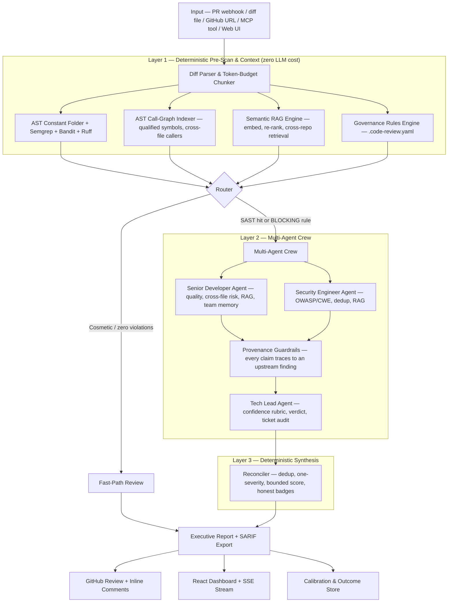

# AI Code Review Agent

<div align="center">

[](https://www.python.org/)
[](pyproject.toml)
[](LICENSE)
[](https://fastapi.tiangolo.com/)
[](https://vitejs.dev/)
[](https://semgrep.dev)
[](https://docs.oasis-open.org/sarif/sarif/v2.1.0/sarif-v2.1.0.html)
[](https://modelcontextprotocol.io)
[](docker-compose.yml)

</div>

An advisory code review service that runs deterministic static analysis before sending any code to an LLM, records every finding with explicit evidence, and talks directly to developers through PR slash commands.

The initial production scope is one trusted GitHub team with human merge authority. Posting is disabled by default. Automated remediation and generated test execution are experimental and off at launch.

---

## Table of Contents

- [Design Principles](#design-principles)
- [Architecture](#architecture)
- [Key Capabilities](#key-capabilities)
- [Quickstart](#quickstart)
- [Configuration](#configuration)
- [Slash Commands](#slash-commands)
- [MCP Server](#mcp-server)
- [Governance Rules](#governance-rules)
- [Evaluation & Benchmarks](#evaluation--benchmarks)
- [Repository Structure](#repository-structure)
- [Testing](#testing)
- [Roadmap](#roadmap)
- [Contributing](#contributing)

---

## Design Principles

**Static analysis runs before the LLM.** SAST scanners (AST constant folder, Bandit, Ruff, optional Semgrep) fire in milliseconds at zero token cost. Their results bound what the LLM can claim, not the other way around.

**Evidence is explicit.** A scanner hit stays `HEURISTIC`. A generated test that asserts a vulnerability is present _confirms_ the defect only if it passes under execution — and execution is off by default. Findings without evidence are withheld or labelled accordingly.

**Determinism at the boundary.** The final synthesis stage is a code-level reconciler, not a second LLM call. It deduplicates findings, assigns one severity per defect from a documented rubric, and produces a score whose terms trace to specific listed findings.

**Fail closed on safety.** Posting to GitHub, automated remediations, and sandboxed test execution each require an explicit opt-in environment variable. The defaults are all off.

---

## Architecture



### Review pipeline summary

| Stage | Cost | Notes |
|-------|------|-------|
| 1. SAST & AST scan | Zero tokens | AST constant folding, optional Semgrep/Bandit/Ruff |
| 2. AST call-graph | Zero tokens | Python native AST; JS/TS/Go via lighter tokenisation |
| 3. Semantic RAG | Optional API call | Gemini 3072-dim or offline hash embedder |
| 4. Governance rules | Zero tokens | `.code-review.yaml` — sub-millisecond, no LLM |
| 5. Multi-agent crew | LLM tokens | Senior Dev + Security Eng run concurrently |
| 6. Synthesis | Zero tokens | Deterministic reconciler, not a second LLM pass |
| 7. Delivery | Optional | GitHub posting is off by default |

---

## Key Capabilities

### Static Analysis (SAST & AST)

- **AST Constant Folding** — resolves bitwise masks, string concatenation, and variable indirection _across statements_ before pattern matching. Catches `MODE = 0o700 | 0o007; chmod(path, MODE)` that line-based scanners miss.
- **Variable Indirection Tracer** — tracks dangerous-function aliases (`deser = pickle.loads; deser(data)`) and path-join chains across assignment boundaries.
- **Comment & Docstring Shield** — zero false positives on commented-out code or doc examples.
- **Optional Semgrep, Bandit, Ruff** — each runs as a subprocess; absence of any tool is logged, not a fatal error.

Supported CWE categories via the AST engine:

| Vulnerability | CWE | Detection Pattern |
|---------------|-----|-------------------|
| Permissive chmod | CWE-732 | Bitwise-folded `0o777` |
| Disabled TLS | CWE-295 | `check_hostname = flag; verify_mode = ssl.CERT_NONE` |
| SQL injection | CWE-89 | Concatenated query into `cursor.execute()` |
| Path traversal | CWE-22 | `os.path.join(dir, user_input)` without canonicalisation |
| Command injection | CWE-78 | `subprocess.run(cmd, shell=True)` with dynamic `cmd` |
| Insecure deserialization | CWE-502 | Aliased `pickle.loads` call |
| Dynamic code execution | CWE-95 | Aliased `eval` / `exec` call |

### Multi-Agent Crew

Three specialised agents, each with assigned skills (reasoning protocols) and tools:

| Agent | Runs | Tools |
|-------|------|-------|
| Senior Developer | In parallel with Security | `CodebaseContextTool`, `RuffTool` |
| Security Engineer | In parallel with Senior Dev | `QuickPatternScannerTool`, optional web search |
| Tech Lead (Synthesis) | After both complete | `CustomRulesTool`, `TestGeneratorTool` |

**Confidence rubric** (deterministic): start at 100, deduct 30 per unresolved CRITICAL, 15 per HIGH, 10 per code-quality CRITICAL or BLOCKING governance rule, 5 per minor/medium/low finding or WARNING. Floor at 0.

### Semantic RAG

The repository is chunked along AST symbol boundaries, embedded, and stored in a cosine-similarity index. Changed code becomes the query; retrieved definitions are re-ranked and injected into agent prompts so the review covers code the diff never touches.

- **Pluggable embedder:** `hashing` (offline, zero-dependency, default), `gemini` (3072-dim), or `sentence-transformers`.
- **Provenance-safe cache:** re-indexes automatically if the embedder changes.
- **Cross-repo:** set `RAG_REPO_ROOTS` to index sibling services.

### Finding Governance

- **Suppression Store** — SQLite WAL, 30-day TTL, severity ceiling blocks auto-suppression of CRITICAL/HIGH findings, tamper-evident audit log.
- **Governance Rules Engine** — YAML-defined `BLOCKING`/`WARNING`/`INFO` policies; zero token cost; sub-millisecond.
- **Calibration Store** — records every finding outcome (accepted / rejected / suppressed) for confidence calibration.

### Delivery

- **GitHub** — Check Runs with line-level annotations; PAT fallback for 403s.
- **GitLab** — Commit statuses.
- **Bitbucket** — Build statuses.
- **Local / air-gapped** — Writes `REVIEW.md` and `.git/ai_review_status.json`.
- **SARIF v2.1.0** — GitHub Code Scanning compatible.
- **MCP Server** — 8 tools for Claude Code, Cursor, Windsurf.

### Experimental Features (off by default)

| Feature | Gate |
|---------|------|
| Generated test execution | `REVIEW_ENABLE_EXPERIMENTAL_TESTS=true` + approved `REVIEW_SANDBOX_IMAGE` |
| Automated remediation commits | `REVIEW_ENABLE_REMEDIATION=true` + `.code-review.yaml` opt-in |
| Review posting to GitHub | `REVIEW_ENABLE_POSTING=true` |

---

## Quickstart

### Option A — Docker Compose (recommended for production)

```bash
git clone https://github.com/hamza1713/AI-Code-Review-Agent.git
cd AI-Code-Review-Agent
cp .env.example .env          # fill in GEMINI_API_KEY and GITHUB_TOKEN
docker compose up --build -d
```

The multi-stage build compiles the React dashboard and serves it from the same container as the API — one command, one port (`http://localhost:8000`).

> [!IMPORTANT]
> For production, set `REVIEW_DOMAIN`, `REVIEW_IMAGE`, `REVIEW_API_TOKEN`, and `REVIEW_DEPLOYED_COMMIT` in `.env` before running. See [docs/OPERATIONS.md](docs/OPERATIONS.md) and [docs/SECURE_OPERATION.md](docs/SECURE_OPERATION.md).

### Option B — Local development (Python + Node)

**Prerequisites:** Python 3.10–3.13 · Node.js 18+ · [`uv`](https://docs.astral.sh/uv/) · a [Gemini API key](https://aistudio.google.com/)

```bash
# Install Python dependencies
uv sync

# Copy and edit environment file
cp .env.example .env

# Terminal 1 — API server (port 8000)
scripts/dev-backend.sh        # Linux/macOS
scripts\dev-backend.bat       # Windows

# Terminal 2 — Frontend hot-reload (port 3000, optional)
scripts/dev-frontend.sh
scripts\dev-frontend.bat
```

### Option C — CLI / one-shot review

```bash
# Install
pip install -e .

# Review a local diff file
code-review-agent --file samples/sql_injection_pr.txt

# Review a live GitHub PR
code-review-agent --pr "owner/repo/pull/42"

# Export SARIF
code-review-agent --file diff.txt --sarif results.sarif

# Start the webhook API server only
review-server

# Start the MCP server (stdio transport)
code-review-mcp
```

### GitHub Actions integration

```yaml
on:
  pull_request:
    types: [opened, synchronize, reopened]

jobs:
  review:
    runs-on: ubuntu-latest
    permissions:
      contents: read
      pull-requests: write
      security-events: write
    steps:
      - uses: actions/checkout@v4
      - uses: hamza1713/AI-Code-Review-Agent@main
        with:
          github_token: ${{ secrets.GITHUB_TOKEN }}
          gemini_api_key: ${{ secrets.GEMINI_API_KEY }}
          sarif_output: results.sarif
      - uses: github/codeql-action/upload-sarif@v3
        if: always()
        with:
          sarif_file: results.sarif
```

### Pre-commit hook

```yaml
# .pre-commit-config.yaml
repos:
  - repo: https://github.com/hamza1713/AI-Code-Review-Agent
    rev: main
    hooks:
      - id: ai-code-review
```

Staged files are reviewed locally; the commit is blocked on `ESCALATE` or `REQUEST CHANGES`.

---

## Configuration

Copy `.env.example` to `.env`. All variables are documented there with their defaults.

### Required

| Variable | Description |
|----------|-------------|
| `GEMINI_API_KEY` | Google Gemini API key — [get one here](https://aistudio.google.com/) |
| `GITHUB_TOKEN` | PAT with `repo` + `pull_requests:write` scopes |
| `GITHUB_WEBHOOK_SECRET` | Webhook signing secret for HMAC validation |

### LLM & Model

| Variable | Default | Description |
|----------|---------|-------------|
| `LLM_MODEL` | `gemini/gemini-2.0-flash` | LLM model identifier (any LiteLLM-compatible string) |
| `MAX_TOKENS` | `4096` | Maximum tokens per LLM response |
| `LLM_REQUEST_TIMEOUT` | `60` | Per-request timeout in seconds |

### Semantic RAG

| Variable | Default | Description |
|----------|---------|-------------|
| `RAG_ENABLED` | `true` | Enable semantic RAG context retrieval |
| `RAG_EMBEDDER` | `hashing` | `hashing` (offline default), `gemini`, or `sentence-transformers` |
| `RAG_EMBEDDING_DIM` | `512` | Dimension for the hashing embedder |
| `RAG_REPO_ROOTS` | — | Comma-separated extra repo roots for cross-repo RAG |

### Interactive PR Bot

| Variable | Default | Description |
|----------|---------|-------------|
| `BOT_ALLOWED_ASSOCIATIONS` | `OWNER,MEMBER,COLLABORATOR` | GitHub author associations permitted for cost-bearing commands |
| `BOT_ALLOWED_USERS` | — | GitLab/Bitbucket username allowlist (fail-closed if unset) |
| `BOT_CLONE_REPO` | `true` | Clone the PR repo into isolated temp dir for RAG/AST indexing |
| `GITLAB_WEBHOOK_SECRET` | — | GitLab webhook secret token |
| `BITBUCKET_WEBHOOK_SECRET` | — | Bitbucket webhook secret |

### Production Security

| Variable | Default | Description |
|----------|---------|-------------|
| `APP_ENV` | `development` | Set to `production` to enable strict fail-closed security |
| `REVIEW_REQUIRE_AUTH` | `true` | Operator-token gate on all API + job endpoints |
| `REVIEW_API_TOKEN` | — | Operator token (min 32 chars). Generate: `python -c "import secrets; print(secrets.token_urlsafe(32))"` |
| `REVIEW_PUBLIC_URL` | `http://localhost:8000` | Externally reachable origin (used in webhook callback URLs) |
| `REVIEW_ENABLE_POSTING` | `false` | Allow the service to post reviews to GitHub/GitLab/Bitbucket |
| `REVIEW_ENABLE_REMEDIATION` | `false` | Allow automated AST-patch commits |
| `REVIEW_ENABLE_EXPERIMENTAL_TESTS` | `false` | Enable sandboxed generated test execution |
| `REVIEW_SANDBOX_IMAGE` | — | Immutable Docker image SHA256 digest for test execution sandbox |
| `QUEUE_DB_PATH` | `webhook_jobs.db` | SQLite queue database path |

### Optional Integrations

| Variable | Description |
|----------|-------------|
| `SERPER_API_KEY` | Enables live CVE/OWASP web search in the Security Engineer agent |
| `LANGFUSE_PUBLIC_KEY` / `LANGFUSE_SECRET_KEY` | Langfuse production trace monitoring |
| `OPENAI_API_KEY` / `ANTHROPIC_API_KEY` / `GROQ_API_KEY` | Alternate LLM providers |

> See [`docs/SECURE_OPERATION.md`](docs/SECURE_OPERATION.md) for the full production security guide.

---

## Slash Commands

Post slash commands in any PR/MR comment. The webhook is acknowledged in milliseconds; commands run off the request path in background workers.

| Command | Who can use | What it does |
|---------|-------------|--------------|
| `/review` | Maintainers | Triggers a fresh full multi-agent review on the current head |
| `/rerun` | Maintainers | Alias for `/review` |
| `/apply <fingerprint>` | Maintainers | Commits a verified AST fix directly to the PR source branch |
| `/suppress <fingerprint> [reason]` | Maintainers | Persists a finding suppression with a 30-day TTL |
| `/unsuppress <fingerprint>` | Maintainers | Removes a suppression and re-audits the finding |
| `/explain <fingerprint>` | All | Root-cause explainer: mechanics, CWE link, fix snippet |
| `/describe` | Maintainers | Generates PR summary + walkthrough table + Mermaid diagram; idempotent |
| `/ask <question>` | All | RAG + AST-grounded Q&A about the PR and codebase |
| `/improve` | Maintainers | Posts GitHub `suggestion` blocks for detected issues |
| `/compliance` | All | Deterministic `.code-review.yaml` check — zero token cost |
| `/ticket` | All | Audits the PR against its linked ticket's acceptance criteria |
| `/memory` | All | Shows the repository's learned team conventions |
| `/learn <rule>` | Maintainers | Teaches a new team convention |
| `/benchmark` | Maintainers | Runs the ground-truth benchmark and posts the scorecard |
| `/help` | All | Lists available commands |

**RBAC:** `/apply` and `/suppress` are strictly gated by author association (`OWNER`/`MEMBER`/`COLLABORATOR` on GitHub; `BOT_ALLOWED_USERS` on GitLab/Bitbucket). Fail-closed — unauthorised contributors receive an explicit 403 and cannot mutate code or suppress findings.

---

## MCP Server

The full review engine is exposed as a [Model Context Protocol](https://modelcontextprotocol.io) server for use in Claude Code, Cursor, Windsurf, and any MCP-compatible client.

```bash
pip install -e .
code-review-mcp      # starts over stdio
```

Add to your MCP client config (e.g. `.mcp.json`):

```json
{
  "mcpServers": {
    "ai-code-reviewer": { "command": "code-review-mcp" }
  }
}
```

| Tool | Description |
|------|-------------|
| `review_diff(diff, repo_root?)` | Full pipeline review — verdict, confidence, findings, evidence badges |
| `scan_sast_patterns(diff)` | Fast deterministic SAST scan only |
| `check_governance_rules(diff, repo_root?)` | Validate a diff against `.code-review.yaml` |
| `find_impacted_callers(target_identifiers, repo_root?)` | AST call-graph query |
| `query_semantic_context(diff, repo_root?)` | Semantic RAG retrieval for a change |
| `get_team_memory(repo_id)` | Repository's learned team conventions |
| `verify_ticket_compliance(pr_diff, ticket_id, ticket_description)` | Audit a diff against ticket acceptance criteria |
| `generate_unit_tests(function_signature, module_path)` | Generate a pytest suite for a function |

---

## Governance Rules

Codify engineering standards in `.code-review.yaml` at the repository root. Rules are validated against a Pydantic schema and evaluated deterministically — zero token cost, sub-millisecond. Test files, scripts, and `__main__` blocks are automatically exempted from non-security quality rules.

```yaml
version: "1.0"
rules:
  - id: "gov-no-raw-sql"
    name: "Forbid raw SQL string interpolation"
    severity: "BLOCKING"
    pattern: "db\\.(?:query|execute)\\s*\\(\\s*f[\"']"
    description: "Raw SQL queries using f-string interpolation are strictly prohibited."
    suggested_fix: "Use parameterized queries: db.query('SELECT * FROM users WHERE id = %s', (user_id,))"

  - id: "gov-no-print-statements"
    name: "Forbid direct print statements in production code"
    severity: "WARNING"
    pattern: "(?<!#)\\bprint\\s*\\("
    description: "print() bypasses structured logging."
    suggested_fix: "Use logger.info(...) or logger.debug(...)"
```

| Severity | Confidence deduction | Verdict impact |
|----------|---------------------|----------------|
| `BLOCKING` | −10 per violation | Contributes to `ESCALATE` |
| `WARNING` | −5 per violation | Contributes to `REQUEST CHANGES` |
| `INFO` | None | Surfaced in recommendations only |

---

## Evaluation & Benchmarks

The project ships a 14-case synthetic scanner regression suite (scorer v2). Predictions depend only on emitted output; matching uses full path, exact line, and defect identity; every unmatched emitted hit counts as a false positive including duplicates.

```bash
# Run the benchmark suite
python -m code_review_agent.benchmarks --publish

# Run deterministic evaluators (zero cost)
pytest tests/eval/ -m deterministic_eval

# Run LLM-as-judge tests (requires GEMINI_API_KEY)
pytest tests/eval/ -m eval
```

A versioned public PR corpus is frozen under `samples/evaluation/` and awaits independent adjudicated labels. Deterministic, model-only, and combined runs must be scored separately. See [`docs/EVALUATION_PROTOCOL_V2.md`](docs/EVALUATION_PROTOCOL_V2.md) and [`BENCHMARK_REPORT.md`](BENCHMARK_REPORT.md).

> [!NOTE]
> Previous accuracy/F1 badges were removed because the old scorer leaked gold verdict labels and ignored unmatched detections. The current recomputed report is in [`BENCHMARK_REPORT.md`](BENCHMARK_REPORT.md).

---

## Repository Structure

```
AI-Code-Review-Agent/
├── .github/workflows/
│   ├── ci.yml                          # Test matrix (Python 3.10–3.13)
│   └── ai-code-review.yml              # Dogfoods action.yml on this repo's own PRs
├── .code-review.yaml                   # This repo's own governance rules
├── .pre-commit-hooks.yaml              # Pre-commit integration
├── .env.example                        # All env variables with defaults and comments
├── action.yml                          # Reusable GitHub Action
├── Dockerfile                          # Multi-stage: frontend build → Python runtime
├── docker-compose.yml                  # Production single-host deployment
├── pyproject.toml                      # Project v2.5.0 metadata + CLI entrypoints
├── run.py                              # Root CLI launcher
│
├── scripts/                            # Dev launchers and release tooling (see scripts/README.md)
│   ├── dev-backend.sh / .bat
│   ├── dev-frontend.sh / .bat
│   ├── freeze_public_corpus_v2.py      # Canonical corpus freeze script
│   ├── pin_images.py                   # Pin Docker images to sha256 digests
│   ├── record_gate.py                  # Record production approval gate attestation
│   ├── release_record.py               # Assemble release record bundle
│   ├── recovery_drill.py               # Exercises the rollback runbook
│   └── smoke_image.py                  # Smoke-test a pinned Docker image
│
├── deploy/
│   └── Caddyfile                       # TLS reverse proxy config for production
│
├── docs/
│   ├── ARCHITECTURE_AND_STRUCTURE.md   # Full layered architecture reference
│   ├── SKILLS.md                       # Agent skill catalog
│   ├── SECURE_OPERATION.md             # Production security, auth, sandbox, limits
│   ├── OPERATIONS.md                   # Day-two operational runbook
│   ├── PILOT_RUNBOOK.md                # Pilot rollout procedures
│   ├── PRODUCTION_ARCHITECTURE.md      # Production deployment topology
│   ├── RELEASE_GATES.md                # Release gate requirements
│   ├── EVALUATION_PROTOCOL_V2.md       # Evaluation methodology and instructions
│   ├── DATA_TRANSFER_POLICY.md         # Data handling and transfer policy
│   ├── MODULES_0_2_COMPLETION.md       # M0–M2 implementation notes
│   ├── MODULES_3_5_COMPLETION.md       # M3–M5 implementation notes
│   ├── MODULES_6_8_COMPLETION.md       # M6–M8 implementation notes
│   └── MODULES_9_13_COMPLETION.md      # M9–M13 implementation notes
│
├── samples/
│   ├── sql_injection_pr.txt            # Sample diff for manual testing
│   ├── simple_formatting_pr.txt
│   └── benchmarks/                     # 14-case ground-truth suite
│       ├── manifest.json
│       └── *.diff
│
├── notebooks/
│   └── finetune_code_review_peft.ipynb # QLoRA/PEFT research track
│
├── frontend/                           # React 19 + Vite + TypeScript dashboard
│   ├── src/
│   │   ├── App.tsx                     # Tabbed SPA shell
│   │   ├── api.ts                      # API client — Bearer auth + SSE streaming
│   │   └── components/
│   │       ├── ReviewInput.tsx         # Diff / file / ZIP / GitHub PR URL input form
│   │       ├── CompleteExecutiveReport.tsx
│   │       ├── FindingsList.tsx
│   │       ├── AnnotatedCodeViewer.tsx
│   │       ├── CalibrationConsole.tsx
│   │       ├── JobsQueueMonitor.tsx
│   │       ├── PipelineProgress.tsx    # Real-time SSE stage progress
│   │       ├── TraceVisualizer.tsx
│   │       └── ...
│   └── e2e/                            # Playwright end-to-end tests
│
├── tests/                              # pytest suite — 690+ tests, 0 failures
│   ├── conftest.py
│   ├── production_fixtures.py
│   ├── test_phase5_trust_and_safety.py # Remediation safety, guardrails, TTL
│   ├── test_modules_{0_2,3_5,6_8,9_13}.py
│   ├── test_calibration_*.py
│   ├── test_mcp_server.py
│   └── eval/                           # Deterministic + LLM-as-judge evaluators
│
└── src/code_review_agent/
    ├── main.py                         # PRCodeReviewFlow orchestrator + CLI
    ├── models.py                       # Pydantic schemas
    ├── review_service.py               # Synchronous review API
    ├── webhook_server.py               # FastAPI gateway + all route registrations
    ├── webhook_queue.py                # SQLite WAL durable job queue
    ├── worker.py                       # Background queue worker
    ├── mcp_server.py                   # MCP tool exposure (8 tools)
    ├── llm_factory.py                  # Multi-provider LLM factory
    ├── github_client.py                # GitHub REST client
    ├── config.py                       # Centralised env-var binding
    ├── diff_parser.py                  # Diff parsing + token-budget chunker
    ├── remediator.py                   # Remediation safety engine + rollback manifests
    ├── suppression_store.py            # 30-day TTL suppression store
    ├── comment_synchronizer.py         # Bi-directional comment deduplication
    ├── sarif_exporter.py               # OASIS SARIF v2.1.0 generator
    ├── benchmarks.py                   # Precision/Recall/F1 ground-truth harness
    ├── gateway_security.py             # Operator-token gate + constant-time auth
    │
    ├── bot/
    │   ├── command_router.py           # Slash-command parsing and dispatch
    │   └── checkout.py                 # Isolated per-platform PR checkout for RAG/AST
    │
    ├── calibration/                    # Outcome tracking and confidence calibration
    │   ├── engine.py
    │   ├── outcome_store.py
    │   ├── persistence.py
    │   ├── audit_sampler.py
    │   ├── reaction_poller.py
    │   ├── api.py
    │   └── contracts.py
    │
    ├── context_engine/
    │   ├── code_graph.py               # Qualified-symbol indexer + caller resolver
    │   ├── context_tool.py             # CodebaseContextTool
    │   └── semantic/
    │       ├── embeddings.py           # Gemini / hashing / sentence-transformers
    │       ├── vector_store.py         # Cosine index + provenance-stamped persistence
    │       ├── engine.py               # AST-chunk → embed → re-rank → inject
    │       └── semantic_tool.py        # SemanticContextTool
    │
    ├── tools/
    │   ├── ast_security_scanner.py     # Two-pass AST scanner + constant folder
    │   ├── sast_scanner.py             # Unified SAST coordinator
    │   ├── bandit_runner.py
    │   ├── ruff_tool.py
    │   ├── semgrep_runner.py
    │   ├── test_generator.py           # pytest suite generator
    │   └── scan_report.py
    │
    ├── platform/                       # Multi-platform Git engine
    │   ├── base.py                     # GitPlatformClient interface + DTOs
    │   ├── factory.py                  # URL → adapter resolution
    │   ├── github_adapter.py
    │   ├── gitlab_adapter.py
    │   ├── bitbucket_adapter.py
    │   └── local_git_adapter.py
    │
    ├── crews/code_review_crew/
    │   ├── crew.py                     # Agent/task assembly
    │   ├── tool_registry.py            # Declarative tool resolution from YAML
    │   └── config/
    │       ├── agents.yaml             # Agent roles, skills, prompt contracts
    │       └── tasks.yaml              # Task definitions and JSON output schemas
    │
    ├── synthesis/
    │   └── reconciler.py               # Deterministic dedup + score + badge synthesis
    │
    ├── compliance/
    │   ├── ticket_parser.py
    │   ├── ticket_fetcher.py
    │   └── intent_engine.py
    │
    ├── governance/
    │   └── rules_engine.py             # .code-review.yaml evaluator
    │
    ├── learning/
    │   ├── team_memory.py              # Best-practices wiki store (per-repo)
    │   └── suggestion_tracker.py       # Verified-acceptance learning on merge
    │
    ├── observability/
    │   ├── telemetry.py                # Per-review token + USD cost tracking
    │   ├── tracer.py                   # Hierarchical decision trace tree
    │   └── alerts.py
    │
    ├── sandbox/
    │   ├── test_runner.py              # Isolated subprocess/Docker execution
    │   └── self_healer.py              # Test self-healing + assertion integrity verifier
    │
    └── eval/                           # Evaluation framework
        ├── corpus.py
        ├── matching.py
        ├── runtime.py
        ├── eval_runner.py
        ├── deterministic_evaluators.py
        └── custom_metrics.py
```

---

## Testing

```bash
# Standard suite (fast tier only — excludes subprocess-backed slow tests)
uv run pytest -v tests/

# Full suite including subprocess-backed tests (bandit/ruff CLI, sandbox)
uv run pytest -v -m slow tests/

# Trust & Safety + remediation guardrails
uv run pytest -v tests/test_phase5_trust_and_safety.py

# Calibration suite
uv run pytest -v tests/test_calibration_*.py

# MCP server surface
uv run pytest -v tests/test_mcp_server.py

# Linting
uv run ruff check src/

# Type checking
uv run mypy src/
```

**Fast tier:** diff parsing, SAST/governance engines, AST call graph, semantic RAG (all embedders), interactive bot (routing + RBAC), team-memory learning loop, ticket compliance, platform adapters, durable webhook queue (concurrent-claim safety), gateway security, MCP tool surface.

**Slow tier:** actual Bandit/Ruff CLI detection accuracy, ground-truth benchmark suite, sandbox real test execution (including credential-stripping verification).

**Trust & Safety tier:** structured AST patch coordinate matching, strict branch guardrails, stale HEAD SHA race condition checks, rollback manifests, 4-tier evidence trust grading, SQLite WAL external side-effect idempotency ledger, worker heartbeat lease renewals, transient vs. terminal error classification, fail-closed Bearer auth, 30-day finding suppression TTLs with severity ceilings.

---

## Roadmap

### Scaling

- **Shared job queue** — pluggable backend (Postgres / Redis) for multi-replica deployments; the current SQLite WAL queue is single-node.
- **Shared team memory & RAG index** — move `TeamMemoryStore` and semantic index to shared storage.
- **Distributed rate limiter** — replace the in-process per-IP limiter with a Redis-backed one.

### Platform parity

- **Bitbucket merge-learning hook** — GitHub and GitLab already learn on merge; Bitbucket pending the `pullrequest:fulfilled` branch.
- **Jira / Linear ticket fetchers** — ticket keys are already parsed; authenticated API clients not yet implemented.
- **Platform-native inline comments** — line-anchored review comments on GitLab/Bitbucket (GitHub is complete).

### Reviewer intelligence

- **Incremental review** — review only what changed since the last push.
- **Confidence calibration from outcomes** — feed merged-vs-reverted signals into the confidence rubric.
- **Richer language AST** — native AST depth beyond Python for the call-graph and chunker.

> These are intended directions, not commitments or dates.

---

## Contributing

1. Fork the repository and create a feature branch.
2. Run `uv run pytest -v tests/`, `uv run pytest -v -m slow tests/`, and `uv run ruff check src/` before opening a PR — CI runs both tiers.
3. Ensure `uv run mypy src/` reports no new errors.
4. Open the PR — the agent reviews its own diff automatically via the dogfooded Action.

---

## License

Apache 2.0 — see [`LICENSE`](LICENSE).

---

<div align="center">

Built with Python · [Google Gemini](https://deepmind.google/technologies/gemini/) · [FastAPI](https://fastapi.tiangolo.com/) · [React 19](https://react.dev/) · [Model Context Protocol](https://modelcontextprotocol.io)

</div>
