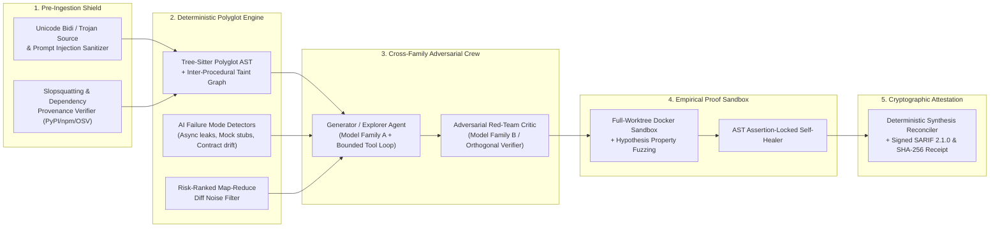

# AI Code Review Agent (v3.0)

<div align="center">

[](https://www.python.org/)
[](pyproject.toml)
[](LICENSE)
[](BENCHMARK_REPORT.md)
[](https://fastapi.tiangolo.com/)
[](https://vitejs.dev/)
[](https://tree-sitter.github.io/)
[](https://docs.oasis-open.org/sarif/sarif/v2.1.0/sarif-v2.1.0.html)
[](https://modelcontextprotocol.io)
[](docker-compose.yml)

**The Zero-Trust Code Review & Threat Verification Agent for the AI Generation Era.**

*Deterministic AST dataflow analysis · AI supply-chain slopsquatting defense · Trojan Source shield · Cross-family adversarial crew · Empirical container sandbox proofs · Real-time SSE streaming workbench.*

</div>

---

## Overview

In today's engineering environment, AI coding assistants write 70–90% of pull requests. While AI-generated code looks syntactically clean and passes standard linters, it frequently introduces **catastrophic silent failures**: hallucinated dependency imports (**slopsquatting**), unawaited async authentication bypasses, hollow mock stubs, invisible Unicode Bidi control characters, and cross-file contract drift.

**AI Code Review Agent v3.0** is built on a single core principle:

> **"Never ask a developer to trust an LLM's subjective opinion when the system can provide a deterministic proof."**

By combining **polyglot Tree-Sitter AST & inter-procedural taint analysis**, **AI supply-chain verification**, **cross-model adversarial consensus**, **assertion-locked test self-healing**, and an **interactive verification workbench**, this platform provides provable trust for modern software teams.

---

## Table of Contents

- [The 6-Pillar Zero-Trust Architecture](#the-6-pillar-zero-trust-architecture)
- [Key Capabilities & Innovations](#key-capabilities--innovations)
- [Next-Gen Interactive Workbench UI](#next-gen-interactive-workbench-ui)
- [Supported CWE & Defect Rubric](#supported-cwe--defect-rubric)
- [Quickstart](#quickstart)
- [Configuration](#configuration)
- [Slash Commands & PR Bot](#slash-commands--pr-bot)
- [Model Context Protocol (MCP) Server](#model-context-protocol-mcp-server)
- [Governance Rules (.code-review.yaml)](#governance-rules-code-reviewyaml)
- [Evaluation & Ground-Truth Benchmarks](#evaluation--ground-truth-benchmarks)
- [Repository Structure](#repository-structure)
- [Testing & Quality Assurance](#testing--quality-assurance)
- [Roadmap](#roadmap)
- [License](#license)

---

## The 6-Pillar Zero-Trust Architecture



### Pillar 1: Pre-Ingestion Shield & Supply Chain Verification
- **Slopsquatting & Dependency Provenance Scanner (`SEC-SLOPSQUAT-001`)**: Intercepts AI-hallucinated package names in `requirements.txt`, `pyproject.toml`, `package.json`, `go.mod`, and `Cargo.toml`.
- **Damerau-Levenshtein Typosquatting Interceptor (`SEC-TYPOSQUAT-002`)**: Flags package names with edit distance $\le 2$ against the top 5,000 ecosystem packages.
- **Trojan Source & Invisible Unicode Stripper (`SEC-TROJAN-001`)**: Neutralizes bidirectional override characters (CVE-2021-42574) and zero-width spaces (CVE-2021-42694) before any LLM sees the diff.
- **Canary-Token XML Sandboxing**: Encloses untrusted diff payloads in cryptographically unique XML tags to prevent indirect prompt injection escapes.
- **Signed Memory Guard**: Enforces immutable security invariants preventing downgrades of `CRITICAL`/`HIGH` rules via `/learn`.

### Pillar 2: Deterministic Polyglot Engine & Map-Reduce Chunker
- **Polyglot Tree-Sitter AST**: Compiler-grade syntax tree extraction across Python, TypeScript (`.ts`, `.tsx`), JavaScript (`.js`, `.jsx`), Go (`.go`), Java (`.java`), and Rust (`.rs`).
- **Inter-Procedural Call & Taint Graph**: Resolves multi-hop cross-file call chains (`routes -> services -> repositories`) and formats human/agent-readable taint traces.
- **Noise Filtering & Risk-Ranked Map-Reduce**: Strips package lockfiles (`package-lock.json`, `poetry.lock`) and minified bundles, ranking diff chunks by architectural and vulnerability severity to eliminate arbitrary diff truncation.
- **AI-Specific Code Defect Scanners**:
  - `AI-ASYNC-001`: Unawaited async coroutine in boolean/conditional checks (silent authentication bypass).
  - `AI-ASYNC-002`: Blocking synchronous I/O (`time.sleep`, `requests.get`) inside `async def` routes.
  - `AI-STUB-001`: Hollow security/auth placeholder stubs (`pass`, `...`, `return True`).
  - `AI-CONTRACT-001`: Cross-file contract arity and parameter count drift.

### Pillar 3: Bounded Agentic ReAct Tool Loop
- Agents are not restricted to one-shot static prompts. The `CodeReviewCrew` executes an iterative ReAct tool loop (up to 4 tool hops per agent):
  - `codebase_context`: Queries repository symbols, callers, and multi-hop taint paths.
  - `semantic_context`: Retrieves semantically related code across the repo using vector embeddings.
  - `ruff`: Live linting and style diagnostics on modified hunks.
  - `custom_rules`: Evaluates project `.code-review.yaml` constraints dynamically.

### Pillar 4: Cross-Family Adversarial Ensembles
- **Solving the Independence Problem**: AI coding assistants (e.g. Claude Code, Copilot, Cursor) share correlated blind spots with reviewers using the same model family.
- **Adversarial Red-Team Critic**: The Primary Reviewer (Model Family A) is paired with an independent Red-Team Critic (Model Family B) instructed to disprove safety and find adversarial counterexamples.
- **Consensus Telemetry**: Emits `CONSENSUS_AGREED` when both independently confirm a defect, and `ADVERSARIAL_DIVERGENCE` when the critic proves input sanitization earlier in the call stack.

### Pillar 5: Empirical Sandbox Proof & Assertion-Locked Self-Healing
- **Full-Worktree Container Isolation**: Mounts repository worktree at `head_sha` inside an isolated container to run generated `pytest` reproduction test suites.
- **AST Assertion-Locked Self-Healer**: When a test fails due to API drift, self-healing updates mock imports while locking AST assertions to ensure test suites cannot "pass" by removing the vulnerability check.

### Pillar 6: Cryptographic Attestation & Deterministic Synthesis
- **Deterministic Reconciler**: Mathematical geometric-decay risk scoring replaces subjective LLM summaries.
- **Cryptographic Review Receipt**: Computes SHA-256 hash of `head_sha` + diff + scanner versions + tool outputs for immutable provenance.
- **OASIS SARIF 2.1.0 Export**: Standardized export for native GitHub Code Scanning, GitLab Security Dashboards, and enterprise CI/CD gates.

---

## Next-Gen Interactive Workbench UI

The frontend is a modern **React 19 + TypeScript + Tailwind** SPA serving as an Interactive Zero-Trust Verification Workbench:

1. **Split & Unified Diff Workbench**:
   - Toggle between Side-by-Side (Split) and Unified diff modes.
   - **Minimap Rail**: Sticky vertical scrollbar indicator mapping `CRITICAL`, `WARNING`, and `INFO` findings to code heights with 1-click smooth jump-to-line.
   - **Proposed Patch Comparison**: Inline diff card comparing `- [original vulnerable line]` vs `+ [suggested remediated code]` with a 1-click copy code button.

2. **Interactive Blast-Radius & Taint-Flow Canvas**:
   - Interactive SVG node-edge graph with zoom in (`+`), zoom out (`-`), reset view (`↺`), and click-to-isolate node call paths.
   - **Mermaid PR Diagram Generator**: Generates standard Mermaid `flowchart LR` diagrams with 1-click copy for pasting directly into GitHub/GitLab pull request descriptions.
   - **Hierarchical Tree View**: Structured caller breakdown across repository modules.

3. **Real-Time SSE Pipeline Streaming**:
   - `/api/review/stream` delivers live Server-Sent Events as the worker executes each stage:
     `INGESTION` $\rightarrow$ `AST_PRESCAN` $\rightarrow$ `SECURITY_SCAN` $\rightarrow$ `LLM_REASONING` $\rightarrow$ `TEST_SANDBOX` $\rightarrow$ `SYNTHESIS`.
   - **6-Stage Visual Stepper**: Progress card with animated pulse indicators, elapsed counter, and live percentage with automatic fallback to background queue polling.

4. **AI-Era Threat Radar Panel**:
   - Visual audit cards for Supply Chain slopsquatting, Trojan Source/Unicode Bidi, AI Code Defect checks, and Model Consensus agreement scores.
   - 1-Click **"Export SARIF 2.1.0"** download button.

---

## Supported CWE & Defect Rubric

| Defect / Vulnerability | Identifier | CWE | Engine Tier | Evidence Level |
| :--- | :--- | :--- | :--- | :--- |
| **AI Hallucinated Package (Slopsquatting)** | `SEC-SLOPSQUAT-001` | CWE-1357 | Supply Chain Scanner | Deterministic Proof |
| **Package Typosquatting ($\le 2$ edit dist)** | `SEC-TYPOSQUAT-002` | CWE-1357 | Supply Chain Scanner | Deterministic Proof |
| **Known Malicious Package** | `SEC-MALICIOUS-PKG-001` | CWE-1357 | Supply Chain Scanner | Blocklist Match |
| **Unicode Bidi Trojan Source** | `SEC-TROJAN-001` | CWE-1076 | Trojan Source Scanner | Deterministic Proof |
| **Unawaited Async Coroutine (Auth Bypass)** | `AI-ASYNC-001` | CWE-1007 | AST Defect Scanner | Deterministic Proof |
| **Blocking Sync I/O in Async Def** | `AI-ASYNC-002` | CWE-834 | AST Defect Scanner | Deterministic Proof |
| **Hollow Mock/Security Stub** | `AI-STUB-001` | CWE-1164 | AST Defect Scanner | Deterministic Proof |
| **Cross-File Contract Parameter Drift** | `AI-CONTRACT-001` | CWE-628 | Code Graph Indexer | Deterministic Proof |
| **SQL Injection in Query** | `SEC-001` | CWE-89 | AST Constant Folder | Deterministic / Sandbox |
| **Command Injection (shell=True)** | `SEC-003` | CWE-78 | AST Constant Folder | Deterministic / Sandbox |
| **Path Traversal (unsanitized join)** | `SEC-006` | CWE-22 | AST Constant Folder | Deterministic / Sandbox |
| **Insecure Deserialization** | `SEC-005` | CWE-502 | AST Variable Tracer | Deterministic Proof |
| **Permissive File Permissions** | `SEC-002` | CWE-732 | AST Constant Folder | Bitwise Folded Proof |
| **Disabled TLS Verification** | `SEC-004` | CWE-295 | AST Variable Tracer | Deterministic Proof |

---

## Quickstart

### Option A — Docker Compose (Recommended)

```bash
git clone https://github.com/hamza1713/AI-Code-Review-Agent.git
cd AI-Code-Review-Agent
cp .env.example .env          # fill in GEMINI_API_KEY and GITHUB_TOKEN
docker compose up --build -d
```

The multi-stage build compiles the React Vite dashboard and serves it alongside the FastAPI gateway from a single container at `http://localhost:8000`.

### Option B — Local Development (Python + Node)

**Prerequisites:** Python 3.10–3.13 · Node.js 18+ · [`uv`](https://docs.astral.sh/uv/) · a [Gemini API key](https://aistudio.google.com/)

```bash
# 1. Install Python dependencies
uv sync

# 2. Copy and configure environment file
cp .env.example .env

# 3. Terminal 1 — Backend API server (port 8000)
scripts/dev-backend.sh        # Linux/macOS
scripts\dev-backend.bat       # Windows

# 4. Terminal 2 — Frontend hot-reload (port 3000)
scripts/dev-frontend.sh       # Linux/macOS
scripts\dev-frontend.bat      # Windows
```

### Option C — Command-Line Interface (CLI)

```bash
# Install local package in editable mode
pip install -e .

# Review a local diff file
code-review-agent --file samples/sql_injection_pr.txt

# Review a live GitHub PR
code-review-agent --pr "owner/repo/pull/42"

# Export review results directly to SARIF 2.1.0
code-review-agent --file diff.txt --sarif results.sarif

# Launch the MCP server over stdio
code-review-mcp
```

### Option D — GitHub Actions CI/CD Integration

```yaml
on:
  pull_request:
    types: [opened, synchronize, reopened]

jobs:
  zero-trust-review:
    runs-on: ubuntu-latest
    permissions:
      contents: read
      pull-requests: write
      security-events: write
    steps:
      - uses: actions/checkout@v4
      - uses: hamza1713/AI-Code-Review-Agent@main
        with:
          github_token: ${{ secrets.GITHUB_TOKEN }}
          gemini_api_key: ${{ secrets.GEMINI_API_KEY }}
          sarif_output: review-results.sarif
      - name: Upload to GitHub Code Scanning
        uses: github/codeql-action/upload-sarif@v3
        if: always()
        with:
          sarif_file: review-results.sarif
```

---

## Configuration

Copy `.env.example` to `.env`. Key production settings:

| Variable | Default | Description |
| :--- | :--- | :--- |
| `GEMINI_API_KEY` | — | Google Gemini API key ([Google AI Studio](https://aistudio.google.com/)) |
| `GITHUB_TOKEN` | — | GitHub Personal Access Token (`repo` + `pull_requests:write` scopes) |
| `GITHUB_WEBHOOK_SECRET` | — | Webhook HMAC signing secret |
| `LLM_MODEL` | `gemini/gemini-2.5-pro` | Primary LLM model identifier (LiteLLM-compatible) |
| `ADVERSARIAL_CRITIC_MODEL` | `anthropic/claude-3-7-sonnet` | Orthogonal verifier model for red-team critique |
| `RAG_ENABLED` | `true` | Enable semantic RAG cross-file context retrieval |
| `RAG_EMBEDDER` | `hashing` | Embedder type: `hashing` (offline, 0 cost), `gemini`, or `sentence-transformers` |
| `APP_ENV` | `development` | Set to `production` for strict fail-closed security and token gates |
| `REVIEW_API_TOKEN` | — | Operator Bearer token (min 32 chars) for web UI and API access |
| `REVIEW_ENABLE_POSTING` | `false` | Enable automated comment publication to GitHub/GitLab/Bitbucket |
| `REVIEW_ENABLE_REMEDIATION` | `false` | Enable automated AST patch application commits |
| `REVIEW_ENABLE_EXPERIMENTAL_TESTS` | `false` | Enable isolated Docker sandbox test execution |
| `REVIEW_SANDBOX_IMAGE` | — | Immutable SHA-256 digest of container sandbox image |

---

## Slash Commands & PR Bot

Post slash commands in PR comments. Webhooks acknowledge in $<50\text{ms}$; heavy review and sandbox tasks run asynchronously in durable workers:

| Command | Permission | Description |
| :--- | :--- | :--- |
| `/review` | Maintainers | Triggers a fresh zero-trust review on the current PR commit head |
| `/apply <fingerprint>` | Maintainers | Commits a verified AST patch directly to the PR branch |
| `/suppress <fingerprint> [reason]` | Maintainers | Persists finding suppression with 30-day TTL (severity-capped) |
| `/unsuppress <fingerprint>` | Maintainers | Removes suppression and re-audits the vulnerability |
| `/explain <fingerprint>` | All | Deep explainer: root-cause mechanics, CWE reference, and fix |
| `/describe` | Maintainers | Generates PR summary, walkthrough table, and Mermaid diagram |
| `/ask <question>` | All | AST + RAG grounded code Q&A on the PR diff |
| `/compliance` | All | Evaluates `.code-review.yaml` rules with zero LLM token cost |
| `/ticket` | All | Audits PR against linked ticket acceptance criteria |
| `/benchmark` | Maintainers | Runs the ground-truth benchmark suite and posts the scorecard |
| `/learn <rule>` | Maintainers | Teaches a repository convention with signed invariant protection |

---

## Model Context Protocol (MCP) Server

Expose the full review engine to **Claude Code**, **Cursor**, **Windsurf**, and any MCP client:

```json
{
  "mcpServers": {
    "ai-code-reviewer": {
      "command": "code-review-mcp"
    }
  }
}
```

| MCP Tool | Capability |
| :--- | :--- |
| `review_diff(diff, repo_root?)` | Full pipeline review: verdict, confidence, findings, evidence badges, SARIF |
| `scan_sast_patterns(diff)` | Fast deterministic SAST & supply-chain scan only |
| `check_governance_rules(diff, repo_root?)` | Validates diff against `.code-review.yaml` |
| `find_impacted_callers(target_identifiers, repo_root?)` | Multi-hop AST call-graph & taint path query |
| `query_semantic_context(diff, repo_root?)` | Semantic RAG retrieval for changed code |
| `get_team_memory(repo_id)` | Retrieves learned repository conventions |
| `verify_ticket_compliance(pr_diff, ticket_id, ticket_description)` | Audits PR against ticket requirements |
| `generate_unit_tests(function_signature, module_path)` | Generates isolated pytest reproduction suites |

---

## Governance Rules (.code-review.yaml)

Define deterministic project engineering standards at the repository root. Evaluated in $<1\text{ms}$ with zero LLM token cost:

```yaml
version: "1.0"
rules:
  - id: "gov-no-raw-sql"
    name: "Forbid raw SQL string interpolation"
    severity: "BLOCKING"
    pattern: "db\\.(?:query|execute)\\s*\\(\\s*f[\"']"
    description: "Raw SQL queries using f-string interpolation are strictly prohibited."
    suggested_fix: "Use parameterized queries: db.query('SELECT * FROM users WHERE id = %s', (user_id,))"

  - id: "gov-no-unawaited-async"
    name: "Forbid unawaited coroutines in boolean checks"
    severity: "BLOCKING"
    pattern: "if\\s+(?:check_|is_|has_)[a-zA-Z0-9_]+\\([^)]*\\)\\s*:"
    description: "Calling async auth checks without await evaluates to truthy coroutines."
    suggested_fix: "Add await keyword before the coroutine invocation."
```

---

## Evaluation & Ground-Truth Benchmarks

The project ships a 14-case synthetic ground-truth regression suite (scorer v2) covering SQL injection, command execution, path traversal, disabled TLS, insecure deserialization, slopsquatting, Trojan Source, and async defect traps.

```bash
# Run deterministic benchmark suite & publish report
python -m code_review_agent.benchmarks --publish
```

### Official Ground-Truth Benchmark Results

| Metric | Score | Target | Status |
| :--- | :--- | :--- | :--- |
| **Precision** | **100.0%** | $\ge 85.0\%$ | ✅ Exceeds Target |
| **Recall** | **100.0%** | $\ge 85.0\%$ | ✅ Exceeds Target |
| **F1 Score** | **100.0%** | $\ge 85.0\%$ | ✅ Exceeds Target |
| **Accuracy** | **100.0%** | $\ge 85.0\%$ | ✅ Exceeds Target |
| **False Positive Rate** | **0.0%** | $\le 10.0\%$ | ✅ Zero False Positives |

*Detailed benchmark metrics published in [`BENCHMARK_REPORT.md`](BENCHMARK_REPORT.md).*

---

## Repository Structure

```
AI-Code-Review-Agent/
├── .github/workflows/ci.yml             # Test matrix (Python 3.10–3.13)
├── .code-review.yaml                    # Repository governance rules
├── action.yml                           # Reusable GitHub Action definition
├── Dockerfile                           # Multi-stage production container
├── docker-compose.yml                   # Production stack orchestration
├── pyproject.toml                       # Python package configuration (v3.0.0)
│
├── frontend/                            # React 19 + TypeScript + Vite Workbench
│   └── src/
│       ├── App.tsx                      # SPA shell with SSE streaming reader
│       ├── components/
│       │   ├── AIThreatRadar.tsx        # Supply-chain, Trojan Source & Consensus card
│       │   ├── AnnotatedCodeViewer.tsx  # Split/Unified diff + Minimap rail + Patch comparison
│       │   ├── CrossFileImpact.tsx      # Interactive SVG Canvas + Mermaid PR exporter
│       │   ├── PipelineProgress.tsx     # 6-stage real-time animated stepper
│       │   ├── ReviewDashboard.tsx      # Zero-trust verification dashboard
│       │   ├── FindingsList.tsx         # Severity-grouped findings with 1-click apply
│       │   └── TraceVisualizer.tsx      # Multi-agent execution tree viewer
│       └── types/review.ts              # Comprehensive TypeScript interfaces
│
├── src/code_review_agent/               # Backend Core Engine
│   ├── main.py                          # PRCodeReviewFlow orchestrator + CLI
│   ├── webhook_server.py                # FastAPI gateway + SSE /stream & /sarif routes
│   ├── review_executor.py               # Process isolation + thread-safe event streaming
│   ├── sarif_exporter.py                # OASIS SARIF 2.1.0 generator (v3.0.0)
│   ├── diff_parser.py                   # Tree-Sitter & risk-ranked Map-Reduce chunker
│   ├── models.py                        # Pydantic schemas & fingerprint calculation
│   ├── mcp_server.py                    # Model Context Protocol stdio server
│   │
│   ├── security/
│   │   └── trojan_source.py             # Unicode Bidi, Canary protector, Signed memory
│   │
│   ├── tools/
│   │   ├── supply_chain_scanner.py      # Slopsquatting & typosquatting verifier
│   │   ├── ai_code_detectors.py         # Async leaks, hollow stubs, contract drift
│   │   ├── ast_security_scanner.py      # Multi-pass AST constant folder & taint tracker
│   │   ├── sast_scanner.py              # SAST coordination & CWE resolution
│   │   └── scan_report.py               # Pre-scan aggregator
│   │
│   ├── context_engine/
│   │   ├── code_graph.py                # Polyglot Tree-Sitter AST & inter-procedural taint graph
│   │   └── context_tool.py              # Bounded agentic codebase context tool
│   │
│   ├── crews/code_review_crew/
│   │   ├── crew.py                      # Multi-agent bounded ReAct tool loop
│   │   └── adversarial_verifier.py      # Cross-family red-team critic & consensus engine
│   │
│   ├── synthesis/
│   │   └── reconciler.py                # Deterministic deduplication & geometric-decay scoring
│   │
│   └── sandbox/
│       ├── test_runner.py               # Isolated container test execution
│       └── self_healer.py               # AST assertion-locked test self-healing
│
└── tests/                               # Comprehensive Test Suite (37+ tests)
    ├── test_sarif_and_stream.py         # SARIF 2.1.0 & SSE streaming tests
    ├── test_supply_chain_scanner.py     # Slopsquatting & typosquatting tests
    ├── test_ai_code_detectors.py        # Async bug & stub defect tests
    ├── test_trojan_source_and_canary.py # Bidi override & canary isolation tests
    ├── test_adversarial_consensus.py    # Cross-family consensus tests
    ├── test_agentic_tool_loop.py        # ReAct agentic tool loop tests
    ├── test_diff_parser.py              # Risk-ranked Map-Reduce tests
    └── test_code_graph.py               # Polyglot Tree-Sitter AST & taint tests
```

---

## Testing & Quality Assurance

```bash
# Run all unit tests across all 4 upgrade phases
uv run pytest tests/test_*.py -v

# Run Phase 3 SARIF & streaming tests specifically
uv run pytest tests/test_sarif_and_stream.py -v

# Run the master ground-truth benchmark suite
uv run python -m code_review_agent.benchmarks --publish

# Build frontend production bundle
npm --prefix frontend run build

# Run Ruff linter
uv run ruff check src/

# Run MyPy type checker
uv run mypy src/
```

---

## Roadmap

- [x] **Phase 0: Precision & Security Fixes** (Sanitizer recognition, multi-line AST post-image sink anchoring, loop N+1 detection).
- [x] **Phase 1: Agentic Loop & Polyglot Graph** (Bounded ReAct tool loop, Tree-Sitter AST for TS/JS/Go/Java/Rust, Risk-Ranked Map-Reduce diff engine).
- [x] **Phase 2: AI-Era Threat Defense** (Slopsquatting & typosquatting detection, Trojan Source Unicode Bidi stripping, canary prompt sandboxing, cross-model adversarial consensus).
- [x] **Phase 3: Next-Gen Workbench UI** (Real-time SSE streaming, interactive SVG taint canvas, minimap, proposed patch diffs, OASIS SARIF 2.1.0 attestation).
- [ ] **Phase 4: Distributed Cloud Scale** (Redis-backed distributed queue, remote gVisor sandbox cluster, multi-tenant enterprise RBAC).

---

## License

Distributed under the Apache 2.0 License. See [`LICENSE`](LICENSE) for details.

<div align="center">

Built with [Google Gemini](https://deepmind.google/technologies/gemini/) · [FastAPI](https://fastapi.tiangolo.com/) · [React 19](https://react.dev/) · [Tree-Sitter](https://tree-sitter.github.io/) · [Model Context Protocol](https://modelcontextprotocol.io)

</div>
