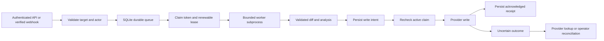

# Production modules 0–2: implementation and completion record

## Scope and status

Modules 0, 1, and 2 are implemented on `codex/production-m0-m2`. The existing uncommitted work was preserved. The starting Git commit was `9f2d12f62d157d226fc31fd9bb69fea2f0f3c4fe` on `main`.

This is a foundation for the planned deployment: one trusted team, one host, SQLite, and two workers. Completion of these modules is not a production release approval. Product publication policy, evaluation quality, dependency hardening, full deployment verification, and later modules still need their own gates. Generated test execution and remediation should remain disabled in the planned production rollout until their separate gates pass.

## Module 0 — recoverable starting point and measured baseline

### What was completed

- Captured 279 tracked and untracked files, including the existing prototype extensions. Recorded two tracked deletions and per-file SHA-256 hashes.
- Verified every archived file against its manifest and checked ZIP integrity.
- Saved a Git HEAD bundle, working-tree binary patch, index patch, starting tracked status, and the original branch/commit identity.
- Backed up the existing `webhook_jobs.db` using SQLite's online backup API and verified database integrity before the queue schema change.
- Created the implementation branch while retaining the dirty working tree.
- Ran the original Python source from an extracted, frozen snapshot so implementation changes could not contaminate the baseline.
- Captured backend tests, lint, the deterministic benchmark, frontend lint, and a frontend build in a separate output directory.

### Evidence location

All local evidence is under `.cache/production-m0-m2/`:

| Artifact | Purpose |
| --- | --- |
| `starting-checkout.zip` / `manifest.json` | Exact tracked and untracked source snapshot and hashes |
| `starting-head.bundle` | Recoverable starting Git history |
| `working-tree.patch` / `index.patch` | Starting changes relative to Git |
| `databases/webhook_jobs.db` | Verified database backup before queue schema 2 |
| `frozen-baseline-tests.log` | Tests of the archived starting source |
| `frozen-baseline-ruff.json` | Existing lint debt |
| `baseline-frontend-lint.log` / `baseline-frontend-build.log` | Frontend baseline |
| `frozen-baseline-benchmark.log` | Original deterministic benchmark |
| `acceptance-tests.log` | Full implementation acceptance run |
| `modules-final-tests.log` | Final focused module regressions |
| `canonical-final-tests.log` | Final publication, reconciliation, and provider contract regressions |
| `final-ruff.json` / `evidence-summary.json` | Lint comparison and changed-file inventory |
| `modules-only.patch` | Implementation diff against the archived dirty checkout |
| `final-benchmark.log` | Benchmark after implementation |

The snapshot excludes Git-ignored secrets and dependency/runtime caches. It includes the non-ignored user source changes. The database backup is separate because copying only a live database file without its WAL is unsafe. These are local backups; copy the verified archive, manifest, bundle, and database backup to your approved backup storage before deleting the workspace or its cache.

### Baseline and implementation results

| Check | Frozen baseline | Implementation |
| --- | --- | --- |
| Full Python suite, including slow tests | 531 passed, 5 skipped | 611 passed, 6 skipped |
| Final publication/security/provider regressions after the last fixes | Not applicable | 197 passed, 1 skipped |
| New path validation / publication / regression files: configured Ruff checks | Not present / previous publication implementation | Pass |
| New path validation and publication files: focused mypy | Not applicable | Pass; untyped function bodies are outside mypy's default coverage |
| Frontend lint | Pass | Frontend source was not changed by these modules |
| Frontend TypeScript/Vite build | Pass | Built to a separate evidence directory |
| Bundled deterministic benchmark | 14 cases, 19 TP, reported F1 and verdict accuracy 100% | Same case counts and scores |
| Repository-wide Ruff | Fails: 1,750 diagnostics | Fails: 1,734 diagnostics; no added diagnostic identities in the comparison |

The bundled benchmark is a small deterministic smoke check. Its scoring and fixture coverage do not demonstrate production precision, recall, helpfulness, or model quality. These modules add security and lifecycle regressions; they do not repair or replace the evaluation methodology.

The full suite passed before the final canonical-target and cancelled-receipt adjustments. The subsequent 197-test run covers those final changes. The module-only patch also passed a reverse-application check against this checkout without modifying files.

## Module 1 — confine patch paths to the intended workspace

### Shared boundary

`path_validation.py` supplies `validate_diff_path`, `safe_diff_path`, and `UnsafeDiffPathError`. Validation checks Windows and POSIX syntax regardless of the host OS.

It rejects absolute paths, traversal, drive-relative paths, UNC and rooted Windows paths, alternate data streams, device names in any component, control characters, ambiguous trailing dots/spaces, and empty or dot components. Filesystem resolution also rejects symlink/junction escapes outside the supplied root. Normal nested paths, spaces, Unicode, and backslash separators are supported.

### Ingestion and filesystem integration

- Diff parsing validates both original Git header paths and subsequent source/target, rename, and copy metadata. Overriding a malicious header with a safe later header cannot bypass validation.
- Removed character-based `lstrip` handling that could transform an unsafe absolute filename into a relative one.
- Supports Git quoted paths and octal UTF-8 filenames. Preserves `/dev/null` as metadata for additions/deletions and preserves it when chunking large diffs.
- Bandit, Ruff, and Semgrep resolve every materialized path through the shared validator before writing. This also protects against a caller supplying forged parsed objects.
- The sandbox uses the same boundary for reconstructed files and repository base-file reads. Unsafe inputs never launch Docker.
- ZIP extraction validates every member before writing any member.
- Browser raw-diff input is rejected with HTTP 422 before synchronous execution, stream setup, or asynchronous enqueueing.
- Worker-side invalid paths map to 422 and queued jobs fail permanently without publication or retries.
- Added a Windows/Linux CI matrix for portable path and scanner regressions.

### Acceptance coverage and limits

Tests exercise traversal, POSIX absolute paths, Windows drives/UNC/device names, streams, malformed or overridden headers, deletion/addition sentinels, Unicode/space filenames, scanner writes, ZIP preflight, browser rejection, sandbox refusal, and terminal queue failures. The local symlink test requires Windows symlink privileges and is skipped on this host; Linux CI provides that filesystem test.

Path resolution is intended for private temporary scanner workspaces and a trusted service host. It does not provide an atomic defense against a hostile local process replacing directories between validation and access.

## Module 2 — durable commands and controlled provider writes

### Execution architecture



### What changed

- Removed webhook `BackgroundTasks` command dispatch. Webhooks persist commands once; the claimed worker executes them.
- Delivery keys include provider, host, repository, PR, and delivery/comment identity. Missing identity headers use a stable payload digest rather than a shared `comment:None` key.
- Missing, partial, expired, cancelled, or replaced claims are rejected. Provider writes cannot use an unclaimed fallback path.
- Remote commands requiring publication or remediation require a claim. Read-only API commands continue to use bounded analysis without publishing.
- Direct CLI/Flow execution generates a report without posting a review. Comment synchronization records local observations without posting resolution comments.
- Reviews bind their analyzed commit in durable job state. A retry cannot silently switch an uncertain write to a newer PR head.
- Reviews, issue comments, check runs, commit statuses, remediation commits, and rollback commits persist write intent before sending. Keys for review/check/status effects are stable for the repository, PR, and analyzed head. Provider targets use canonical identities so a PR URL and its shorthand reference share the same intent.
- Removed fabricated mock receipt handling. Successful acknowledgements require actual provider IDs or commit SHAs.
- Retries retain the original write intent. Saved review responses must satisfy the real response schema; incomplete saved data is not given fabricated defaults.
- Published finding identities and the intended review event survive reconciliation and suppression changes on a retry.
- Uncertain review/comment writes search for the stable operation marker and configured bot author. Failed or ambiguous lookup cannot trigger another write.
- Checks, statuses, and branch mutations with uncertain outcomes require operator reconciliation. Automatic lookup for these effects is not implemented.
- Remediation persists its rollback draft before sending. After reconciliation or a local bookkeeping failure, it can restore the original result and audit record without a second commit, even if the PR head has advanced.
- Windows worker cleanup retries transient file locks for a bounded interval so cleanup cannot replace a deadline error or leak worker capacity. Persistently locked temporary directories are logged for operator cleanup.

### API and schema changes

1. **Queue schema is version 2.** The additive `external_operation_jobs` table links each operation to its participating jobs. Existing jobs and operation records are retained. Older code refuses the newer queue schema.
2. **`POST /api/remediation/apply` returns HTTP 202** with `{status: "accepted", job_id: "…"}`. Poll the authenticated job/result endpoints for completion. The existing remediation deployment gate still applies.
3. **API `/apply` commands are queued**, including requests with `auto_post=false`. Direct remediation/rollback calls need an active job claim to commit remotely.
4. **`POST /jobs/{job_id}/reconcile` no longer invents receipts or resolves all writes on the same PR.** The operator supplies the exact linked operation key and provider receipt. The original intent is preserved. Failed/reconciliation-required jobs are requeued to finish bookkeeping and remaining effects. Receipts for cancelled jobs can be recorded, but those jobs remain cancelled and cannot be resumed through this endpoint.
5. **Retry and cancel preserve pending intents.** Neither action asserts provider delivery. A retry still has to reconcile an existing uncertain intent before progressing.

Example operator reconciliation after verifying the provider's actual receipt:

```json
{
  "action": "reconcile",
  "operation_key": "review:github:github.com:org/repo:42:ANALYZED_HEAD",
  "receipt": {"id": 123456},
  "notes": "Verified the operation marker and review ID on the provider."
}
```

For a remediation commit, provide its actual `sha` instead of a review `id`. Never clear or delete a pending intent to force another send. Legacy pending records without job links require explicit offline inspection before repair; the API does not guess their owner.

### Acceptance coverage

The regression suite covers real SQLite claims and migration, repeated webhook delivery, concurrent publication, missing claims, real receipt requirements, accepted writes with lost responses, restart and lease replacement, cancellation during publication, ambiguous lookup, commit/head changes, exact operation reconciliation, remediation audit recovery, direct Flow publication prevention, and terminal unsafe-input failure.

The guarantee is durable intent plus controlled reconciliation. A provider may accept an in-flight request immediately before cancellation or lease loss; cancellation cannot undo that request. Such writes remain pending until their outcome is established. This design does not claim a distributed transaction with the provider.

## Rollout and rollback

1. Review the module-only diff and completion record.
2. Run the Windows/Linux CI path job. It is configured but has not been executed remotely from this workspace.
3. Stop admission and drain workers. Make a fresh verified SQLite online backup before deploying queue schema 2.
4. Stop the service; deploy the new code using the existing single-host migration procedure. Keep publishing, remediation, and generated test execution disabled during initial checks.
5. Verify authenticated queue admission, worker leases, replay of a test delivery, invalid-diff rejection, and operator reconciliation in an approved test repository.
6. Update consumers of the remediation API for HTTP 202 and job polling.
7. Rollback requires the previous code and its matching database backup. Do not run the previous image against queue schema 2.

To recover the starting development checkout, first preserve the current implementation. Restore the bundle and verified ZIP into a separate directory, compare the manifest, account for its two recorded deletions, and inspect the saved index/working-tree patches. Stop the application before restoring the database. Do not blindly overwrite this dirty working tree.

## Remaining release gates

- Repository-wide lint is still failing on existing code. Completion of M0 records this debt; it does not make CI green.
- Docker isolation and privileged filesystem cases were skipped locally. The configured Linux/Windows CI and deployment integration gates still need execution.
- Live provider delivery, a clean production image, off-host restoration, frontend browser regressions, dependency/secret scans, and the broader release checklist have not been established by this implementation run.
- Advisory publication policy, meaningful quality evaluation, and the remaining planned production modules are still required before selling this as a production-ready service.
