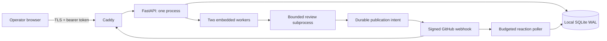
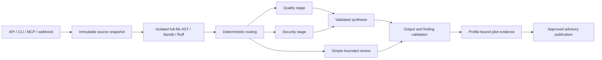

# Production contracts and recovery

The server validates repository targets and derives actor identity. Provider permissions are checked before queued commands and checked again at execution. Claims have unique attempt tokens. Heartbeat, failure, completion and publication require the active token and an unexpired lease. Recovery reclaims only expired claims and counts crash attempts toward the retry limit.

`ReviewAPIResponse.findings` is the canonical typed collection; existing `pattern_findings`, governance and report fields remain compatible. `analysis_complete`, `analyzer_status`, `analyzed_commit`, per-finding `evidence_provenance`, `finding_id`, `pr_id`, and `publication_status` make incomplete or unpublished results explicit. A review-wide test result never upgrades unrelated findings. Finding-specific evidence requires a fingerprint, analyzed commit, recorded test ID, execution flag and reproduction outcome.

Finding identity is `(provider, host, repository, PR, fingerprint)`. Revisions update one occurrence; other PRs create another. Publication, feedback, audit and reaction snapshots are recorded as append-only events. Current occurrence columns are projections for querying; snapshots retain earlier evidence. Lifecycle signals never manufacture true-positive ground truth. Suppression has a separate audit trail and expiry.

Feedback/audit accepts `finding_id`. Legacy repository/fingerprint lookup returns 404 for unknown and 409 for ambiguous occurrences. Invalid outcome/reason combinations return 422; unauthorized actions return 403. Supplied `source`/`audited_by` labels never authorize or determine attribution. `/api/calibration/contracts` supplies canonical UI enums. Metrics use SQL aggregation over confirmed first-publication timestamps and return denominators plus `has_triaged_data`.

Provider writes are not transactional with SQLite. The outbox persists intent and a stable marker before sending. A lost acknowledgement is reconciled through complete paginated provider reads; uncertainty blocks automatic retry. Receipts and the analyzed response are retained so retries cannot replace the original analysis with a different model result. SQLite backup/restore and a matching image/database rollback are the recovery boundary for this initial deployment.

## Native review pipeline and provenance

HTTPX transports have one typed request/response boundary and no provider/model fallback. Models receive prepared scanner, governance and verified repository context; they cannot invoke tools. Production calls recheck repository/model approval immediately before every request, including retries and concurrent stages. Complex review requires both upstream schemas and grounded synthesis; failure retains deterministic evidence, marks the response incomplete and withholds publication.

Snapshots bind raw file bytes, hashes, exact analyzed commit and coverage. Commit-tree modes and blob hashes are verified for GitHub source, including forks. A matching HEAD with dirty/untracked context is not a verified checkout. Full scanners run with isolated settings and paths in private workspaces, never import reviewed modules, and filter to added target lines. Coverage limits and unavailable measurements remain explicit in API/frontend responses.

Reviewer profiles separate application/model/prompt/scanner/policy/memory identity from PR input identity. Pilot schema v2 migrates with a verified backup and paused advisory controls. Historical unversioned evidence remains readable and is excluded from promotion. Production publication checks the active implementation, current memory revision, exact deployed release and retained evidence again.
